# Readings with Rehanon


[View the live site](https://readings-with-rehanon-392f3147072a.herokuapp.com/)

## 💻 Developer

- Rehanon Mackenzie — [GitHub](https://github.com/Rehanon-Mackenzie)

## Instructions

To test the full booking journey:

1. **Register** for an account using the Register link in the navigation. An account is needed so you can manage your bookings and keep your birth details private.
2. **Choose a reading** from the Readings page and click **Book this reading**.
3. **Pick a date and time** from the available slots, then enter your birth date, birth time and place of birth.
4. **Pay at checkout** using the Stripe test card below.
5. A **payment confirmation page** will appear with your order number, and a confirmation email will be sent to the address you registered with (please check your spam folder if it doesn't arrive).
6. Go to **My Account &rarr; My Bookings** to see your upcoming and past bookings. Upcoming bookings have **Reschedule** and **Cancel** buttons, available up to 48 hours before reading.

**Stripe test card:** `4242 4242 4242 4242`, any future expiry date, any CVC, any postcode.
## Table of Contents

- [About](#about)
- [User Experience (UX)](#user-experience-ux)
  - [Target Audience](#target-audience)
  - [Agile Methodology](#agile-methodology)
  - [User Stories](#user-stories)
- [Design](#design)
  - [Colour Scheme & Typography](#colour-scheme--typography)
  - [Wireframes](#wireframes)
  - [App Structure](#app-structure)
  - [Database Schema](#database-schema)
  - [Booking & Payment Flowchart](#booking--payment-flowchart)
- [Features](#features)
  - [Existing Features](#existing-features)
  - [Future Features](#future-features)
- [Business Logic](#business-logic)
- [E-commerce](#e-commerce)
- [Authentication & Authorisation](#authentication--authorisation)
- [Tools & Technologies](#tools--technologies)
- [Testing](#testing)
  - [Known Bugs and Fixes](#known-bugs-and-fixes)
  - [Known Issues](#known-issues)
- [Deployment & Local Development](#deployment--local-development)
  - [Heroku Deployment](#heroku-deployment)
  - [PostgreSQL](#postgresql)
  - [Stripe](#stripe)
  - [Email](#email)
  - [WhiteNoise](#whitenoise)
  - [Local Development](#local-development)
  - [Local vs Deployment](#local-vs-deployment)
- [Credits](#credits)
- [Acknowledgements](#acknowledgements)

---

## About

This project is an extension of my first milestone project, [Rehanon Mackenzie Astrology](https://github.com/Rehanon-Mackenzie/Rehanon-Mackenzie-Astrology), in which I created a static website to advertise my astrology and tarot reading service. That site could not handle bookings or payments, so a prospective client who wanted a reading had to email me and pay by bank transfer.

This full-stack site allows clients to book and pay for a reading online, and to manage their bookings by rescheduling or cancelling them within the booking policy.

It also helps me manage my time more effectively, as I can post the times I am available to read astrology and tarot, and bookings and payments are handled in one place without back-and-forth emails.

## User Experience (UX)

### Target Audience

* People who are interested in astrology and tarot who want a personal reading.
* Returning clients who want to book again and manage their appointments.
* People buying a reading as a gift, using someone else's birth details.
* The site owner (me), who needs to manage readings and available times without using the Django admin.

### The 5 Planes of UX

#### 1. Strategy

**Purpose**
* Advertise the services offered
* Enable users to book and pay for the services
* Display client reviews to encourage prospective clients to book

**Primary User Needs**
* Find out what readings are offered, what they include and what they cost.
* Trust the reader before booking.
* Book a reading at a time that suits them.
* Pay securely online.
* Reschedule or cancel a booking without having to email.
* Book a reading as a gift for someone else.

**Business Goals**
* Sell the services offered
* Enable booking and payment in one place
* Inform users about astrology and tarot

#### 2. Scope

**[Features](#features)** (see below)

**MVP Summary**
> A clear and responsive site that advertises the readings offered and allows clients to book and securely pay for the reading of their choice online.

#### 3. Structure

**Information Architecture**
- **Navigation Menu**
  - Clear accessible links visible at all times via the navbar.
- **Hierarchy**:
  - Call to action buttons placed throughout.
  - Clear and prominent placement of the input fields.
  - Visible confirmation and error messages.

**User Flow**
1. User lands on the homepage and learns about the reader and the readings offered.
2. Browses the Readings page and chooses a reading.
3. Registers or logs in when prompted to book.
4. Chooses an available date and time.
5. Enters their birth details in the booking form and submits it.
6. Pays securely at checkout.
7. Sees a confirmation page and receives a confirmation email.

#### 4. Skeleton

**[Wireframes](#wireframes)** (see below)

#### 5. Surface

**Visual Design Elements**
- **[Colours and typography](#colour-scheme--typography)** (see below)

### Agile Methodology
This section documents the decisions made in the planning phase of the build. I applied Agile methodology to plan this build. Specifically, I used GitHub Issues and a Kanban board to plan out the requirements and worked with MoSCoW prioritisation method to create a minimum viable product. This allowed me to think of what was absolutely necessary in this iteration of the app and what could be developed in future versions.

**Start of project (27 September 2026)**


**Middle of the project (7 October 2026)**
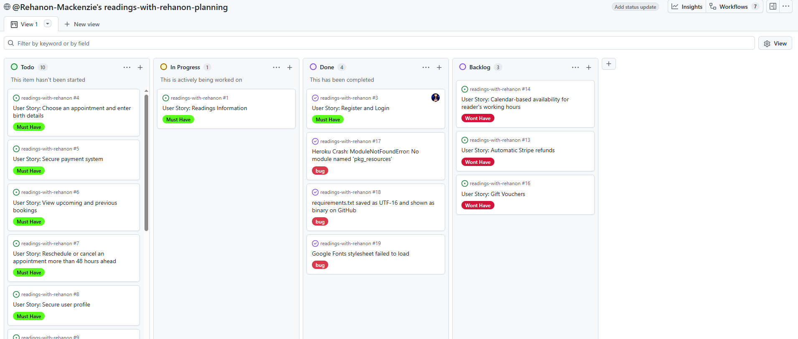

MoSCoW prioritisation was used to keep the project in scope:

- **Must have** — core booking, payment and account features required for the site to work.
- **Should have** — features that improve the experience but aren't essential.
- **Could have** — nice extras, added only if time allowed.
- **Won't have** — deliberately left out of this version (see [Future Features](#future-features)).

### User Stories

| # | As a… | I can… | So that… | Priority |
| --- | --- | --- | --- | --- |
| 1 | visitor | see the reading types, with prices and descriptions | I can choose the right reading |  |
| 2 | visitor | register and log in | I can book and manage my readings |  |
| 3 | client | choose an available date and time and enter my birth details | my reading is booked and prepared | |
| 4 | client | pay securely by card and see a clear result | I know my booking is confirmed | |
| 5 | client | view my upcoming and past bookings | I can keep track of my appointments | |
| 6 | client | reschedule or cancel more than 48 hours ahead | I can fit readings around my plans |  |
| 7 | site owner (admin) | add, edit and remove reading types and slots on the site | I can run my business without the Django admin |  |
| 8 | client | know nobody else can see or change my bookings | my personal details stay private |  |
| 9 | client | get a confirmation email after paying | I have a record of my booking |   |
| 10 | client | have my birth details saved to my profile | booking again is quicker |   |
| 11 | visitor | see a helpful page if I follow a broken link | I can get back to the site easily |   |
| 12 | client | leave, edit and delete a review | I can share my experience | |
| 13 | gift buyer | book a reading using someone else's birth details | I can give a reading as a present |  |
| 14 | site owner (admin) | enter my working hours and breaks | the system can automatically create slots for booking | |
| 15 | client | cancel my bookings within the cancellation period | I receive an automatic refund |  |
| 16 | gift voucher recipient | use my voucher on the site | I can choose which reading I want to receive |  |

All Must Have stories, and Should Have stories 9 and 11, were built in this version. Story 13 is met by the booking form, which accepts anyone's birth details and tells the client so. Stories 10 and 12 were not built in this version and have moved to [Future Features](#future-features)

## Design
I began sketching the project out on paper and writing out the different components in pseudocode to get an overall view of what I wanted to create.  Once I had the app's requirements from the planning stage I then started to design the build. This included capturing what data would be stored in the back-end of the app and how it would be organised in an Entity Relationship Diagram (ERD).

Once I had clarified this I then documented the flow of the app and used this to design the user interface.

### Colour Scheme & Typography

I have carried the colour scheme over from my static site for brand consistency and the decisions behind the colour choices remain the same.  

​I chose these colours because they are closely associated with spirituality specifically the chakra points. These include purple for the crown chakra which is associated with higher wisdom. Blue through the throat chakra and speaking from a place of wisdom. Finally, raspberry pink is associated with passion, excitement and creativity which is always what I hope a birth chart reading will give to people especially when they come for one when they are at a significant crossroads in their life.

| Colour | Hex | Use |
| ------ | --- | --- |
| Purple (crown chakra) | `#32174d` | Navbar, footer, buttons |
| Blue (throat chakra)| `#63b4d1` | Accents |
| Raspberry pink (passion and creativity) | `#e30b5c` | Button hover and highlights |


**Typography:** [Lora](https://fonts.google.com/specimen/Lora) for headings and [Hind Madurai](https://fonts.google.com/specimen/Hind+Madurai) for body text, both from Google Fonts. Lora's serif headings create a mystical effect, while Hind Madurai keeps the body text clean and readable.


### Wireframes

I used [Balsamiq](https://balsamiq.com/) to plan the layout of the GUI and determine what templates were needed.

| Device | Page | Layout |
| ------ | ---- | ------ |
| Desktop | Home | 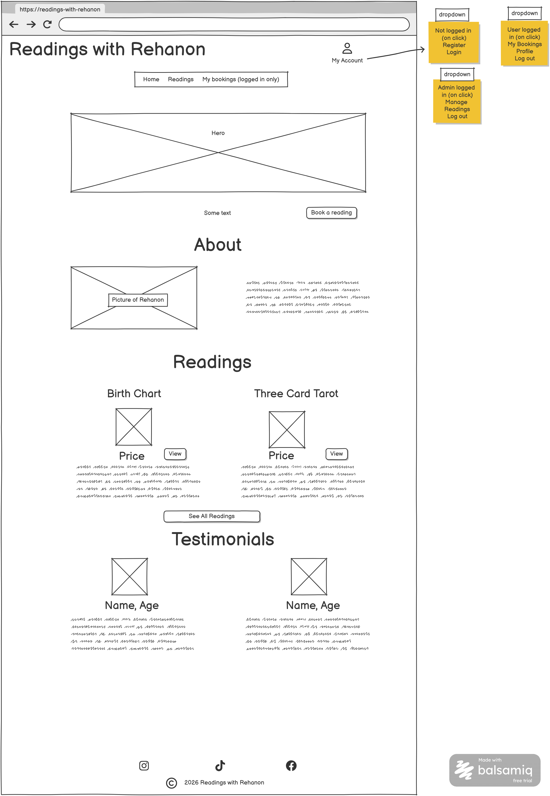 |
| Desktop | Readings | 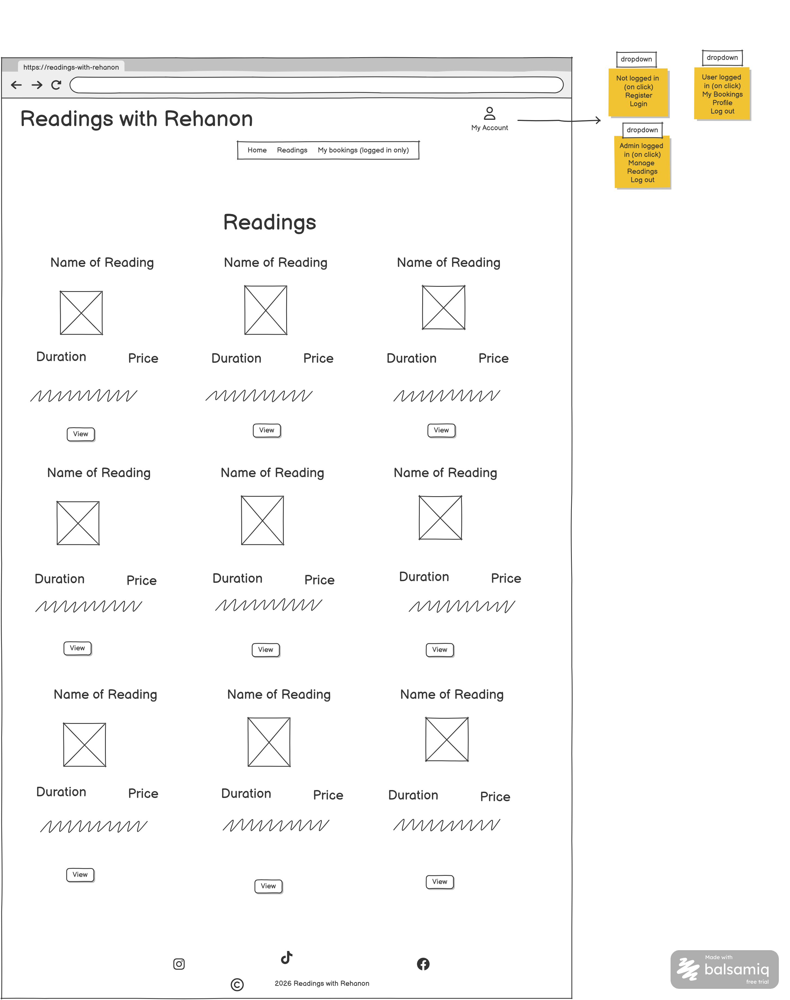 |
| Desktop | Reading Details | 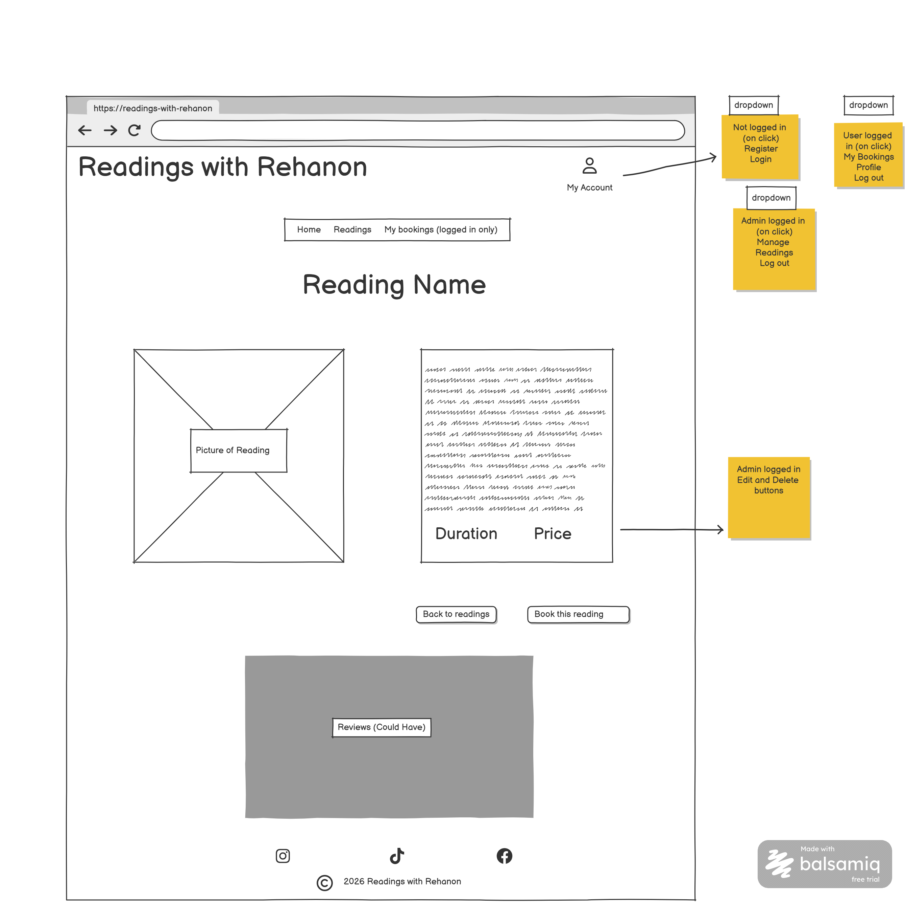 |
| Desktop | Booking | 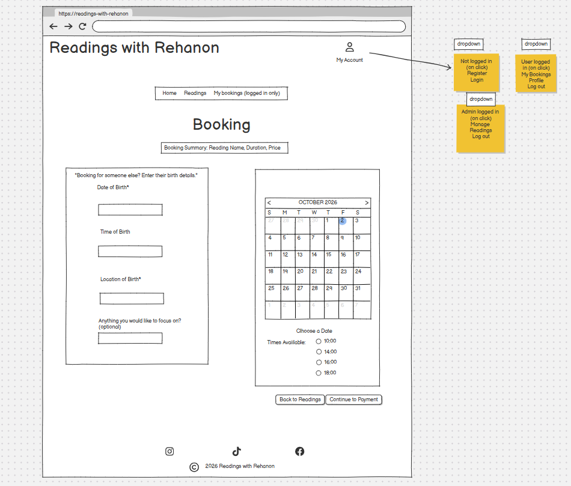 |
| Desktop | Checkout | 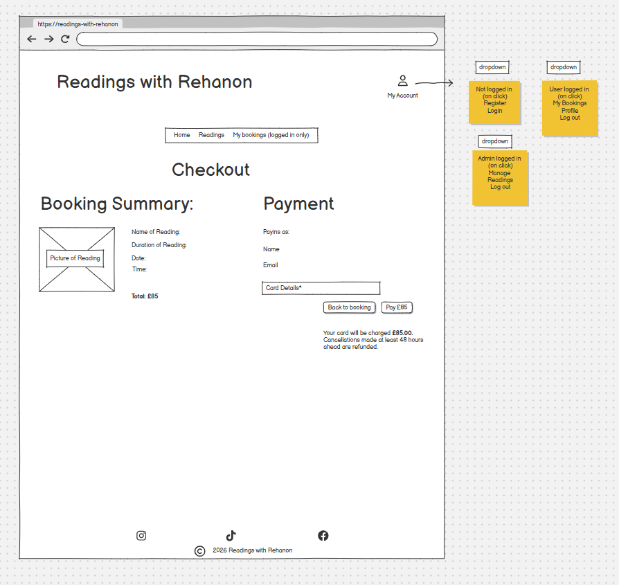 |
| Desktop | Confirmation | 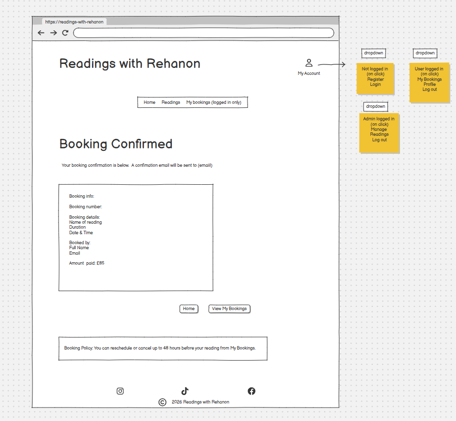 |
| Desktop | My bookings | 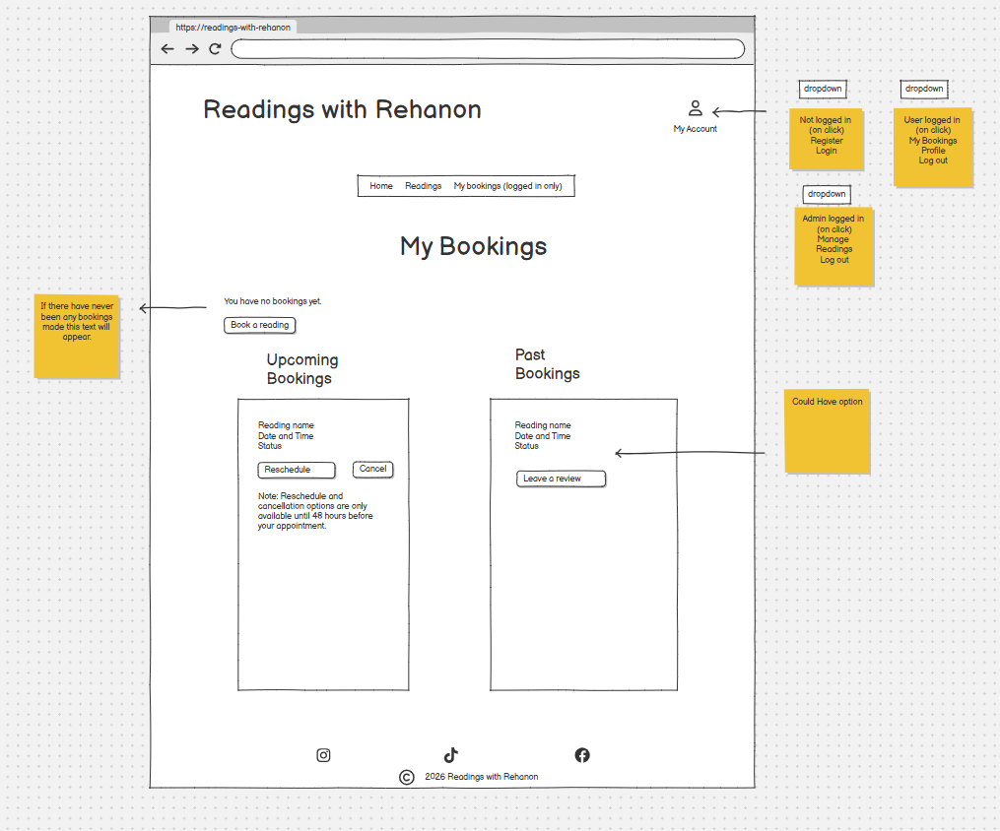 |
| Mobile | Home | 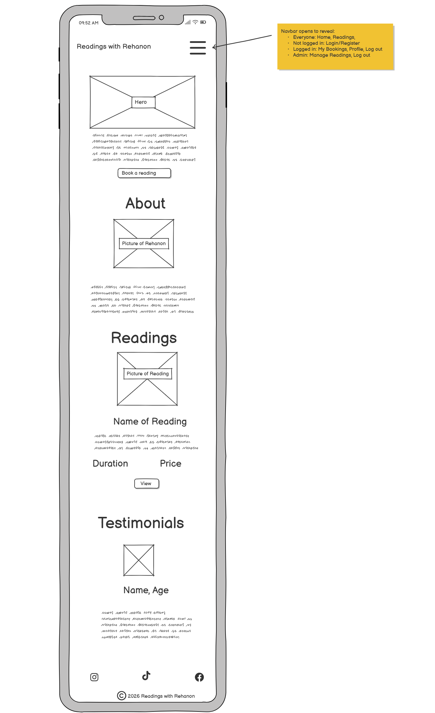 |

### App Structure

The project is split into apps so that each one holds a set of models and views that link to each other.

| App | Purpose |
| --- | --- |
| `home` | Landing page, about section, featured readings, custom 404 page |
| `readings` | Reading types on offer (list, detail, and add, edit, hide and delete for the site owner) |
| `bookings` | Available slots and client bookings (book, view, reschedule, cancel), and slot management for the site owner |
| `checkout` | Stripe payment, orders, webhook handling, confirmation emails |

### Database Schema


#### ReadingType

| Field | Type | Notes |
| --- | --- | --- |
| name | CharField | unique |
| slug | SlugField | unique, created from the name |
| summary | CharField(200) | short text for the reading cards |
| description | TextField | |
| price | DecimalField | |
| duration_minutes | PositiveIntegerField | |
| image | CloudinaryField | optional |
| is_active | BooleanField | hides a reading without deleting it |

#### AvailabilitySlot

| Field | Type | Notes |
| --- | --- | --- |
| start_time | DateTimeField | unique |
| end_time | DateTimeField | |
| is_booked | BooleanField | kept in step with the slot's booking |

`clean()` stops a slot ending before it starts or being added in the past.

#### Booking

| Field | Type | Notes |
| --- | --- | --- |
| user | ForeignKey → User | |
| reading_type | ForeignKey → ReadingType | protected from deletion |
| slot | ForeignKey → AvailabilitySlot | protected from deletion |
| birth_date | DateField | can't be in the future |
| birth_time | TimeField | optional |
| birth_place | CharField | |
| question | TextField | optional |
| status | CharField (choices) | pending / confirmed / cancelled |
| created_on | DateTimeField | auto |

A conditional `UniqueConstraint` allows only one booking per slot that isn't cancelled, so cancelled slots can be booked again while the cancelled booking is kept as history.

#### Order

| Field | Type | Notes |
| --- | --- | --- |
| booking | OneToOneField → Booking | |
| order_number | CharField | 12 characters, generated, unique |
| amount | DecimalField | |
| stripe_pid | CharField | Stripe Payment Intent ID, unique |
| paid_on | DateTimeField | set automatically |

### Booking & Payment Flowchart

I used [Mermaid Editor](https://www.mermaideditor.io/) to create the flowchart, which GitHub renders using [Mermaid](https://mermaid.js.org/) that is clearer.

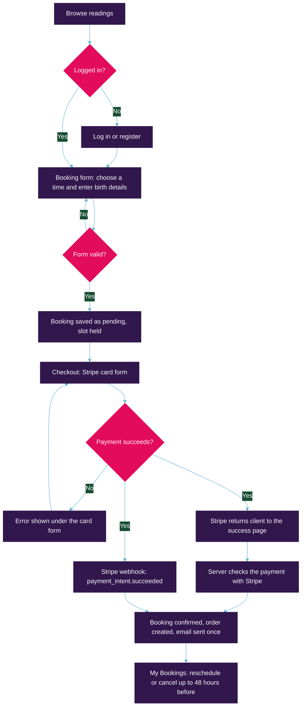

## Features

### Existing Features

| Feature | Notes | Screenshot | User Story |
|----|----|----| ---- |
| Favicon | The favicon is a small image that displays in the browser tab. The intention is to enhance the user experience for those who have multiple tabs open and cannot read the text in the tabs.  I carried over the planet mercury icon from my first project for its astrological relevance. |  |  |
| Navbar and footer | Links to Home, About, Readings and Contact on every page. The My Account menu changes for visitors, clients and the site owner. The footer links to my social media. |  | 1, 2 |
| Home page | Hero, about me, featured readings pulled from the database, client testimonials and contact details. |  | 1 |
| Readings list | Cards for each reading with an image, summary, duration and price. | 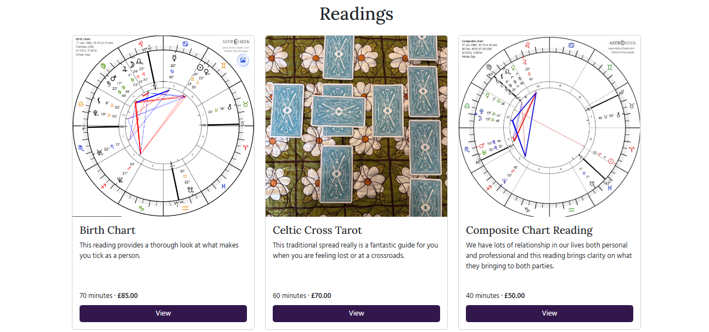 | 1 |
|Reading detail | Full description, duration, price and a Book this reading button. | 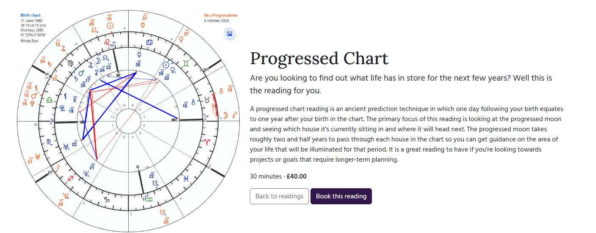 | 1, 3 |
| Registration | Visitors create an account so that they can book, pay and manage their bookings privately. | 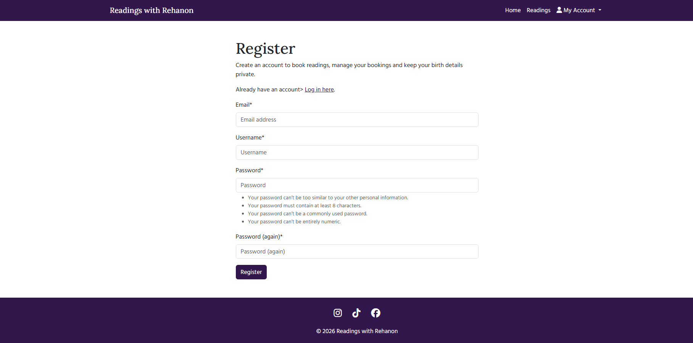 | 2 |
| Login | Secure login is required  before booking. There is an option to remember the user's details. | 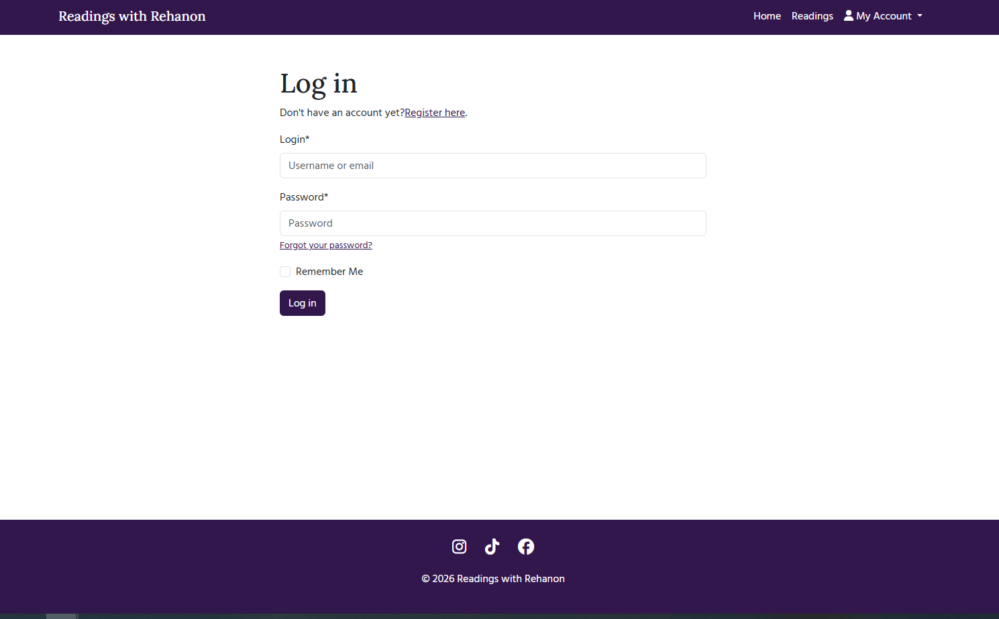 | 2 |
| Logout | Secure logout protects the user's data. | 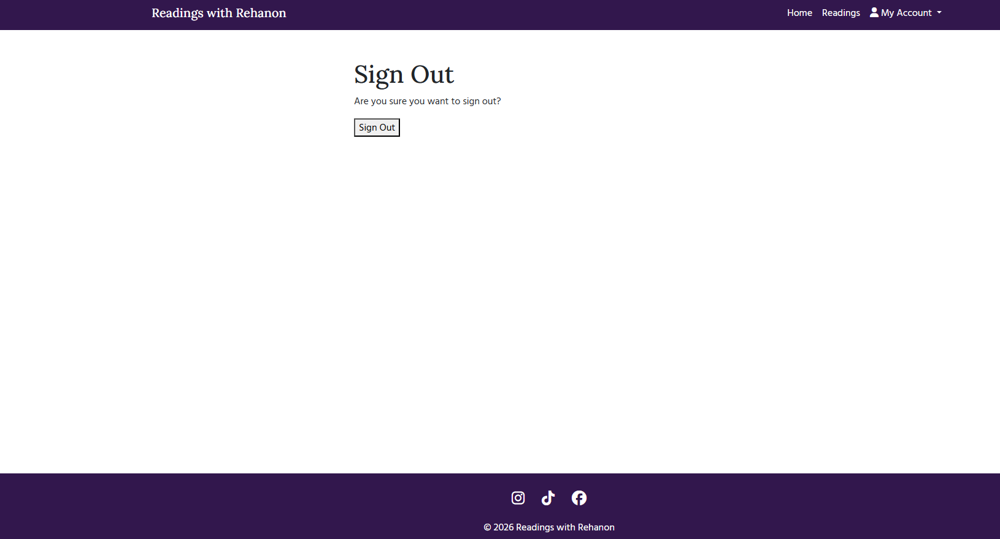 | 2|
| Booking form | Offers only free, future times long enough for the reading, and collects birth details. Help text explains that gift buyers can enter someone else's details. |  | 3, 13 |
| Checkout | Stripe's secure card form, with the reading, time and price. Declined cards show an error under the form. | 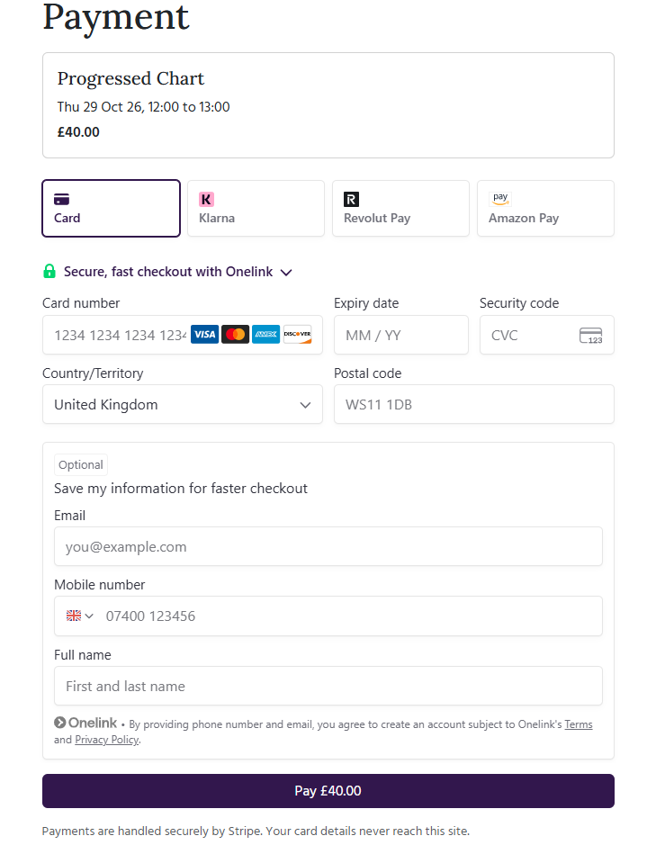 | 4 |
| Payment success page | Confirms the booking and shows the order number. | 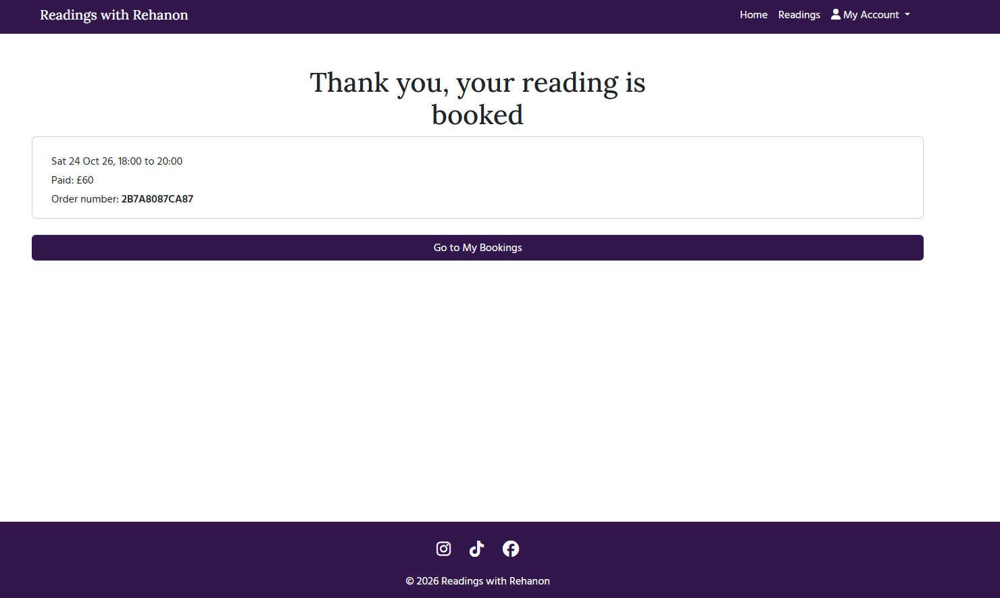| 4 |
| Confirmation email | Sent once when a booking is confirmed, with the reading, time, amount and order number. | 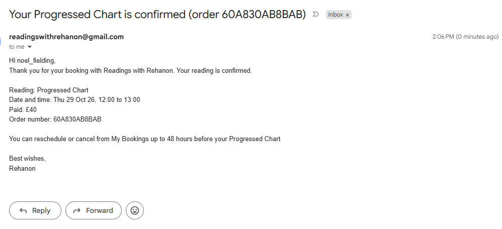 | 9 |
| My Bookings | Upcoming and past or cancelled bookings, with status badges. Unpaid bookings show a Pay now button. | 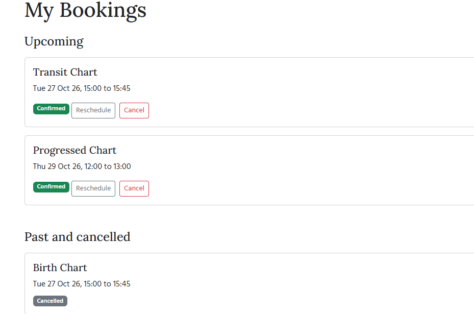 | 5, 8 |
| Reschedule | Move a booking to another free time that fits the reading, up to 48 hours before your appointment. | 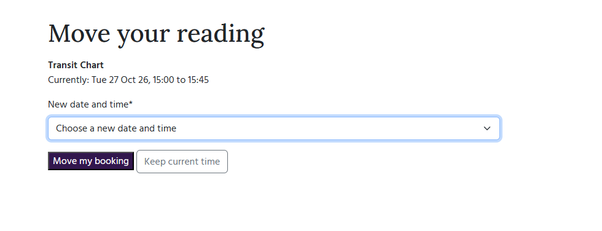| 6 |
| Cancel | Confirmation page before cancelling. The time is released for other clients. | 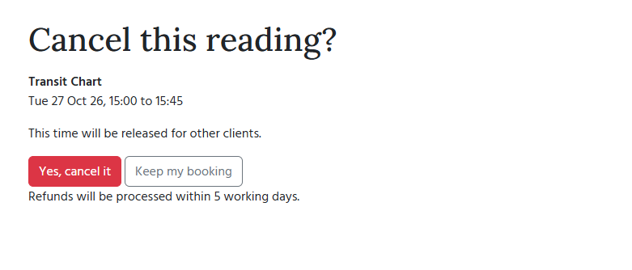 | 6 |
| Manage Readings | The site owner can add, edit, hide and delete readings, including images. | 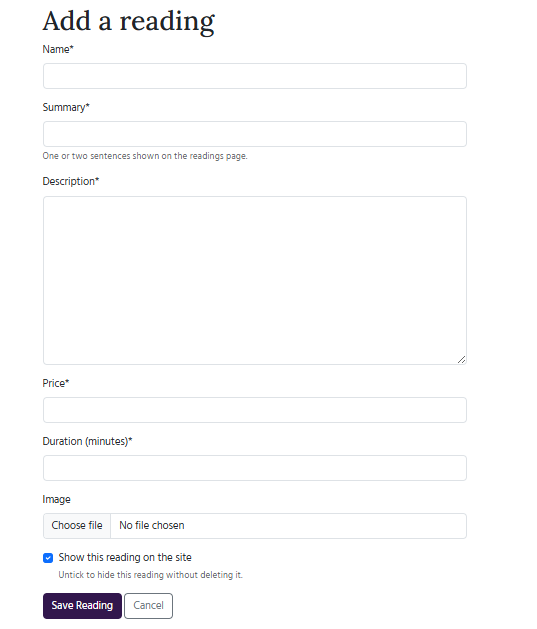| 7 |
| Manage Slots | The site owner can add and delete available times. Slots show Free or Booked, and slots with booking history can't be deleted. | 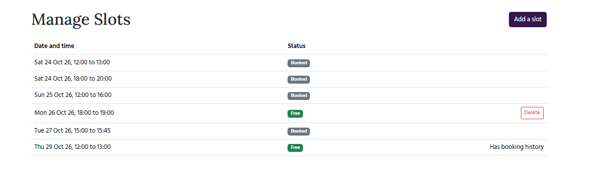 | 7 |
| Messages | Success and error messages confirm every action. | 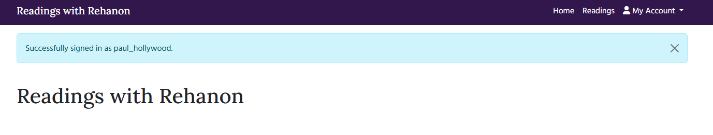 | 2-7 |
| 404 page | A friendly page with links back to the home page and the readings. |  | 11 |

### Future Features

* Save birth details to a client profile so booking again is quicker (user story 10)
* Client reviews (user story 12)
* Automatic Stripe refunds on cancellation
* Calendar-based availability built from the reader's working hours
* Gift vouchers
* Unpaid bookings automatically released after a set time
* The site owner cancelling and rescheduling client's bookings from the site rather than the Django admin
* A contact form

## Business Logic

* **Double-booking prevention:** a database `UniqueConstraint` on `Booking` allows only one booking per slot that isn't cancelled (`condition=~Q(status='cancelled')`). The booking is saved and the slot is marked as booked inside a single transaction, and if two people submit at the same moment the `IntegrityError` is caught and the second person is asked to choose another time. 
* **Slots must fit the reading:** `available_slots_for()` in `bookings/forms.py` only offers free, future slots that are at least as long as the chosen reading, with the length worked out in the database using `F()` expressions. I added this after manual testing showed a 45-minute slot could be booked for a 70-minute reading.
* **Slot availability stays correct:** `Booking.save()` keeps each slot's `is_booked` flag in step with its bookings, so it is correct however a booking is changed: on the site, in Django admin or by the Stripe webhook.
* **48-hour rule:** `Booking.can_be_changed()` in `bookings/models.py` returns `False` for cancelled bookings and bookings starting within 48 hours. The Cancel and Reschedule buttons and both views use this one method, so the rule lives in one place.
* **Payment confirmation:** bookings start as *pending* and only become *confirmed* through `confirm_booking_payment()` in `checkout/payments.py`. Both the success page and the Stripe webhook call it, and `get_or_create` makes it safe to run twice: one order, one email.
*  **Validation:** birth dates can't be in the future, birth time is optional, and `AvailabilitySlot.clean()` stops slots ending before they start or being added in the past.
* **Slot management:** slots with any booking history can't be deleted, which keeps records intact.
* **Owner-only pages:** a custom `superuser_required` decorator, built with `functools.wraps` and `login_required`, protects the management pages.

## E-commerce

* **Payment model:** a one-off payment per booking using Stripe Payment Intents and the Stripe Payment Element. The price comes from the database and is converted into pence on the server, so it can't be changed in the browser.
* **Flow:** book a slot (the booking is saved as *pending* and the slot is held) &rarr; checkout page &rarr; card details go straight to Stripe &rarr; Stripe returns the client to the success page, which checks with Stripe that the payment succeeded and belongs to this booking &rarr; booking confirmed, order created, email sent.
* **Webhook:** Stripe also sends `payment_intent.succeeded` to `/checkout/wh/`, so the booking is confirmed even if the client closes the browser before the success page loads. The message's signature is verified with the webhook secret, and events for other payments are acknowledged and ignored.
* **Feedback:** card errors appear under the form, the success page shows the order number, and a confirmation email is sent. Email problems are logged and can never stop a paid booking being confirmed.
* **Refunds:** cancellations more than 48 hours ahead are refunded manually through the Stripe dashboard. Automatic refunds are a future feature.

## Authentication & Authorisation

* **Why an account is needed:** clients need one to book, pay and manage their bookings, and to keep their birth details private.
* **django-allauth:** handles registration, login and logout.
* **Owner-only data:** every booking view looks bookings up with `user=request.user`, so another user gets a 404 even if they guess a booking's number in the URL.
* **Site owner:** reading and slot management are restricted to superusers. Clients are redirected home with a message, and logged out users are sent to log in.
* **Card details never reach this site.** They go directly to Stripe.

## Security

* **Secrets:** keys and passwords are stored in `env.py` locally (listed in `.gitignore`, so never committed) and in Heroku Config Vars in production.
* **DEBUG** is off on the live site, so error pages never show code or settings.
* **CSRF protection** is on every form. The only exception is the Stripe webhook, which is protected instead by verifying Stripe's signature with the webhook secret.
* **Passwords** are hashed by Django and checked by its password validators.
* **Card details** never touch this site. They go straight to Stripe through the Payment Element.
* **Prices** are taken from the database on the server, and payments are checked with Stripe on the server, so neither can be changed in the browser.
* **Owner-only lookups:** bookings are always fetched with `user=request.user`, so guessing another booking's URL returns a 404.
* **Protected records:** `on_delete=PROTECT` stops readings or slots with bookings with readings being deleted.
* **Clickjacking protection:** Django's `XFrameOptionsMiddleware` stops the site being embedded in another site's frame.
* **Images** are served from Cloudinary over HTTPS only.

## Tools & Technologies

| Tool/Tech | Use |
|----|----|
| [](https://git-scm.com) | Version control. (git add, git commit, git push, git pull) |
| [](https://github.com/) | Secure online storage, Issues and the project board |
| [](https://code.visualstudio.com/) | Local IDE for development |
| [](https://en.wikipedia.org/wiki/HTML) | Main site content and layout |
| [](https://developer.mozilla.org/en-US/docs/Web/CSS) |Design and layout |
| [](https://www.javascript.com/) | Stripe card form on the checkout page |
| [](https://getbootstrap.com/) | Front-end CSS framework for responsiveness and pre-built components|
| [](https://fontawesome.com/) | Icons |
| [](https://fonts.google.com/) | Fonts |
| [](https://www.python.org/) | Back end programming |
| [](https://www.djangoproject.com/) | Python framework for web application development|
| [](https://docs.allauth.org/) | Registration, login and logout |
| [](https://stripe.com/) | Online payments and webhooks |
| [](https://cloudinary.com/) | Hosting reading images |
| [](https://mail.google.com/) |  Sending confirmation emails (SMTP) |
| [](https://django-crispy-forms.readthedocs.io/) | Bootstrap 5 styling for forms |
| [](https://www.heroku.com/) | Hosting the deployed site |
| [](https://www.postgresql.org/) | Relational database |
| [](https://whitenoise.readthedocs.io/) | Serving static files on Heroku |
| [](https://gunicorn.org/) | Web server on Heroku |
| [](https://balsamiq.cloud/) | For creating wireframes |
| [](https://www.dbdiagram.io/) | ERD |
| [](https://mermaid.js.org/) | Booking and payment flowchart |
| [](https://www.freepik.com/) | Star sign icons |
| [](https://favicon.io/) | Favicon generator |
| [](https://flake8.pycqa.org/) | Checking and fixing PEP8 style locally |
| [](https://claude.ai/) | Used to help initial planning, explaining concepts, debugging and assisting with the automated testing |
| [](https://youtube.com/) | Tutorials and explanations of Django features |

## Testing
> [!NOTE]
> Please see the separate [TESTING.md](TESTING.md) file for all the tests carried out.

- test-driven development (TDD) with Django's automated tests
- manual testing of every user story
- validators: W3C HTML, Jigsaw CSS, JSHint and the CI Python Linter (PEP8)
- Lighthouse, accessibility and responsiveness
- Stripe payment testing (successful and declined cards, and the webhook)

### Known Bugs and Fixes

| Bug | Cause | Fix |
| --- | --- | --- |
| Heroku Crash: ModuleNotFoundError: No module named 'pkg_resources' | The installed version of gunicorn imports pkg_resources, which is no longer included with newer Python versions. The .python-version had been saved inside the readings_with_rehanon app folder instead of the project root, so Heroku ignored it and used Python 3.14 instead of 3.13.| Upgraded gunicorn to a version that doesn't need pkg_resources. Moved .python-version (3.13) to the project root. |
| Google Fonts stylesheet failed to load | A typo in the Google Fonts address in base.html: '700@display=swap' should have been '700&display=swap'. | Replaced the @ with & so the address is valid. |
| requirements.txt saved as UTF-16 and shown as binary on GitHub | PowerShell's pip freeze > requirements.txt saved the file as UTF-16. GitHub shows it as 'Binary file not shown' and Heroku may not be able to read it. |  Re-save as UTF-8 and use Out-File -Encoding utf8 in future. |
| Visiting `/bookings/5/cancel/` gave a 404 page saying the path "didn't match" | The URL pattern was `<int:pk>/`, missing `cancel`. The automated tests passed because `reverse()` builds the URL from whatever the pattern says. | Changed the pattern to `<int:pk>/cancel/`. Found by typing the address during the manual testing. |
| `IntegrityError` when cancelling a second booking on the same slot | The live database still had an old version of the double-booking constraint (without `~`). The migration file had been fixed and remade under the same name so `migrate` skipped it. | Rolled back with `migrate bookings 0001`, then ran `migrate` again. Lesson: roll back an applied migration before replacing its file. |
| The Log in link on the sign-up page went to `/accounts/signup/{%'account_login}` | The template tag was missing `url` and the closing `%` so Django left it as plain text. | Changed it to `` and added a test that checks the link.|
| A 45-minute slot could be booked for a 70-minute reading | The booking form offered every free slot, whatever its length. | Only slots at least as long as the chosen reading are offered, for both booking and rescheduling. |
| Server error (500) on the payment success page on Heroku | The `MAILERS` setting paired Gmail's SMTP options with the console backend. The error only showed in Heroku's logs once `LOGGING` was configured. | Corrected the backend, and wrapped email sending in `try/except` so an email problem can never break a payment. |
| Cancelling a booking in the Django admin didn't free its slot | The slot was only freed by site's cancel view. | Moved the logic into `Booking.save()` so the slot stays correct however a booking is changed. |
| W3C: 'No p element in scope' on reading detail | `linebreaks` adds its own `<p>`, so it was nested inside another `<p>` | Changed the wrapper to `<div>` |

More bugs, including those found by the automated tests are recorded in [TESTING.md](TESTING.md).

### Known Issues

* An unpaid (*pending*) booking keeps its slot held until it is paid for or cancelled. Automatically releasing unpaid bookings in a set time is a future feature.
* Refunds are made manually through the Stripe dashboard.
* The site owner cancels clients' bookings through the Django admin. The slot is freed correctly, but there is no owner-facing cancel page yet.
* Confirmation emails come from a new Gmail address, so they may land in spam at first.
* The Stripe Payment Element may show extra payment methods depending on the settings in the Stripe dashboard.

## Deployment & Local Development

### Heroku Deployment

The live deployed app can be found at [Readings with Rehanon](https://readings-with-rehanon-392f3147072a.herokuapp.com/)

This project uses [Heroku](https://www.heroku.com/) as a Plafomr as a Service (PaaS) that enables developers to build, run, and operate applications entirely in the cloud.

Deployment steps are as follows after account setup:
- Select **New** in the top right-hand corner of your Heroku Dashboard, and select **Create new app** from the dropdown menu.
- Your app name must be unique, and then choose a region closest to you (EU or USA), then finally click **Create App**.
- From the new app **Settings**, click **Reveal Config Vars**, and set your environment variables to match your private `env.py` file.

>[!Important]
> This is a sample only; you would replace the values with your own if cloning/forking my repository.

| Key | Value|
|----|----|
| `DATABASE_URL` | user-inserts-own-postgres-database-url |
| `SECRET_KEY` | any-random-secret-key |
| `CLOUDINARY_URL` | user's own value |
| `STRIPE_PUBLIC_KEY` | user's own value |
| `STRIPE_SECRET_KEY` | user's own value |
| `STRIPE_WH_SECRET` | user's own value |
| `EMAIL_HOST_USER` | user's own value |
| `EMAIL_HOST_PASS` | user's own value |

DEBUG is deliberately not set on Heroku.

Heroku needs some additional files in order to deploy properly.
- [requirements.txt](/requirements.txt)
- [Procfile](/Procfile)
- [.python-version](/.python-version)

You can install this project's [requirements.txt](/requirements.txt) (where applicable) using:
- `pip3 install -r requirements.txt`

If you have your own packages that have been installed, then the requirements file needs updating using:
- `pip3 freeze --local > requirements.txt`

The [Procfile](/Procfile) can be created with the following command:
- `echo web: gunicorn app_name.wsgi > Procfile`
- *replace `app_name` with the name of your primary Django app name; the folder where `settings.py` is located

The [.python-version](/.python-version) file tells Heroku the specific version of Python to use when running your application.
- `3.13` (or similar)

For Heroku deployment, follow these steps to connect your own GitHub repository to the newly created app:

Either (*recommended*):
- Select **Automatic Deployment** from the Heroku app.

Or:
- In the Terminal/CLI, connect to Heroku using this command: `heroku login -i`
- Set the remote for Heroku: `heroku git:remote -a app_name` (*replace `app_name` with your app name*)
- After performing the standard Git `add`, `commit`, and `push` to GitHub, you can now type:
    - `git push heroku main`

The Python terminal window should now be connected and deployed to Heroku.  

### WhiteNoise
This project uses the [WhiteNoise](https://whitenoise.readthedocs.io/en/latest/) to aid with static files temporarily hosted on the live Heroku site.

To include WhiteNoise in your own projects:
- Install the WhiteNoise package:
    - `pip install whitenoise`
- Update the `requirements.txt` file with the newly installed package:
    - `pip freeze --local > requirements.txt`
- Edit your `settings.py` file and add WhiteNoise to the `MIDDLEWARE` list, above all other middleware (apart from Django's "SecurityMiddleware"):

```` Python
# settings.py

MIDDLEWARE = [
    'django.middleware.security.SecurityMiddleware',
    'whitenoise.middleware.WhiteNoiseMiddleware',
    # any additional middlware
]
````

### Local Development
This project can be cloned or forked to make a local copy on your own system.

For either method, you will need to install any applicable packages found within the [requirements.txt](requirements.txt) file.

- `pip3 install -r  requirements.txt`.

You will need to create a new file called `env.py` at the root-level, and include the same environment variables listed above from the Heroku deployment steps.

>[!Important]
>This is a sample only; you would replace the values with your own if cloning/forking my repository.

Sample `env.py` file:

```` Python
import os

os.environ.setdefault("SECRET_KEY", "any-random-secret-key")
os.environ.setdefault("DATABASE_URL", "user-inserts-own-postgres-database-url")
os.enviiron.setdefault("CLOUDINARY_URL", "user-inserts-own-cloudinary-url")
os.enviiron.setdefault("STRIPE_PUBLIC_KEY", "user-inserts-own-stripe-public-key")
os.enviiron.setdefault("STRIPE_SECRET_KEY", "user-inserts-own-stripe-secret-key")
os.enviiron.setdefault("STRIPE_WH_SECRET", "user-inserts-own-stripe-wh-secret")


# local environment only (do not include these in production/deployment!)
os.environ.setdefault("DEBUG", "True")
````

Once the project is cloned or forked, in order to run it locally, you'll need to follow these steps:
- Start the Django app: `python3 manage.py runserver`
- Stop the app once it's loaded: `CTRL+C` (*Windows/Linux*) or `⌘+C` (*Mac*)
- Make any necessary migrations: `python3 manage.py makemigrations --dry-run` then `python3 manage.py makemigrations`
- Migrate the data to the database: `python3 manage.py migrate --plan` then `python3 manage.py migrate`
- Create a superuser: `python3 manage.py createsuperuser`
- Load fixtures (*if applicable*): `python3 manage.py loaddata file-name.json` (repeat for each file)
- Everything should be ready now, so run the Django app again: `python3 manage.py runserver`

If you would like to backup your database models, use the following command for each model you'd like to create a fixture for:
- `python3 manage.py dumpdata your-model > your-model.json`
- *repeat this action for each model you wish to backup*
- **NOTE**: You should never make a backup of the default *admin* or *users* data with confidential information.

#### Cloning

You can clone the repository by following these steps:

1. Go to the repository for this project [Rehanon-Mackenzie/readings-with-rehanon](https://github.com/Rehanon-Mackenzie/readings-with-rehanon).
2. Locate and click on the green "Code" button at the very top, above the commits and files.
3. Select whether you prefer to clone using "HTTPS", "SSH", or "GitHub CLI", and click the "copy" button to copy the URL to your clipboard.
4. Open "Git Bash" or "Terminal".
5. Change the current working directory to the location where you want the cloned directory.
6. In your IDE Terminal, type the following command to clone the repository:
    - `git clone https://www.github.com/Rehanon-Mackenzie/readings-with-rehanon.git`
7. Press "Enter" to create your local clone.

Alternatively, if using Ona (formerly Gitpod), you can click below to create your own workspace using this repository.

[](https://gitpod.io/#https://www.github.com/Rehanon-Mackenzie/readings-with-rehanon)

**Please Note**: in order to directly open the project in Ona(Gitpod), you should have the browser extension installed.  A tutorial on how to do that can be found [here](https://ona.com/docs/classic/user/configure/user-settings/browser-extension).

#### Forking

By forking the GitHub Repository, you make a copy of the original repository on your GitHub account to view and/or make changes without affecting the original owner's repository. You can fork this repository by using the following steps:

1. Log into GitHub and locate [Rehanon-Mackenzie/readings-with-rehanon](https://github.com/Rehanon-Mackenzie/readings-with-rehanon).
2. At the top of the Repository, just below the "Settings" button on the menu, locate and click the "Fork" button.
3. Once clicked, you should now have copy of the original repository in your own GitHub account.

### Local VS Deployment

| --- | Local | Heroku |
| --- | ----- | ------ |
| DEBUG | True | Off |
| Error pages | Django debug page | Custom 404/500 |
| Emails | Printed to terminal | Sent via Gmail SMTP |
| Stripe webhook | Stripe CLI forwarding | Direct to `checkout/wh/` |
| Static files | Django dev server | WhiteNoise |

### PostgreSQL

This project uses a [Code Institute PostgreSQL Database](https://dbs.ci-dbs.net/) for the Relational Database with Django.

>[!Caution]
>- PostgreSQL databases by Code Institute are only available to CI students.
>- You must acquire your own PostgreSQL database through some other method if you plan to clone/fork this repository.
>- Code Institute students are allowed a maximum of 8 databases.
>- Databases are subject to deletion after 18 months.

To obtain my Postgres Database from Code Institute, I followed these steps:
- Submitted my email address to the CI PostgreSQL Database link above.
- An email was sent to me with my new Postgres Database.
- The Database connection string will resemble something like this:
- `postgres://<db_username>:<db_password>@<db_host_url>/<db_name>`
- You can use the above URL with Django; simply paste it into your `env.py` file and Heroku Config Vars as `DATABASE_URL`.

### Stripe

1. Create a Stripe account and switch to test mode.
2. Get the public and secret keys from Developers → API keys.
3. Add a webhook endpoint: https://YOUR-APP.herokuapp.com/checkout/wh/
4. Select events: `payment_intent.succeeded`.
5. Copy the signing secret to STRIPE_WH_SECRET. 

To test the webhook locally, the [Stripe CLI](https://docs.stripe.com/stripe-cli) can forward events with `stripe listen --forward-to localhost:8000/checkout/wh/`. It prints its own signing secret for `env.py`.

### Email

1. Create a Gmail account for the site and turn on **2-Step Verification**
2. Create an **App Password** in the Google account's security settings.
3. Add the Gmail address as `EMAIL_HOST_USER` and the app password(without spaces) as `EMAIL_HOST_PASS`.

When these are set, `settings.py` uses Gmail's SMTP server through Django 6.1's `MAILERS` setting. When they aren't set, for example in local development, emails are printed to the terminal instead.

## Credits

### Code

* [Django documentation](https://docs.django.project.com) for models, constraints, `annotate()`, `F()` expressions and testing.
* [Stripe documentation](https://docs.stripe.com/payments/payment-element) for Payment Intents, the Payment Element and webhooks.
* [django-allauth documentation](https://docs.allauth.org/) for authentication.
* [Python docs: functools.wraps](https://docs.python.org/3/library/functools.html#functools.wraps) for the `superuser_required` decorator.
* [Bootstrap 5 documentation](https://getbootstrap.com/docs/5.3/) for layout and components.
* Code Institute's Boutique Ado walkthrough for general approach to Stripe checkout and webhooks, adapted for a booking system.
* Deployment and README layout based on Code Institute's templates.

### Content

* All written content is my own and adapted from milestone project 1 [Rehanon Mackenzie Astrology](https://github.com/Rehanon-Mackenzie/Rehanon-Mackenzie-Astrology).
* Testimonials were provided by previous clients of mine with their permission.

### Media
* Profile and tarot photographs are my own.
* Astrological chart images were created using [Astro-Seek](https://www.astro-seek.com).
* Star sign icons from [Freep!k](https://www.freepik.com)
* Favicon from my first project, generated with [favicon.io](https://favicon.io)


## Acknowledgements
* My tutor, Manu at Bristol College for his help and support throughout the course it was truly appreciated. 
* Code Institute's practical based teaching of code that has allowed me to actually build things that work!
* Friends and family who have listened to me when I was struggling with the learning process and were always willing to manually test for me. You're gems and I'm blessed.
* [codebar brighton](https://codebar.io/brighton) is part the wider codebar network and who are always so encouraging of folks wanting to learn to code who are't always represented in tech.
* Finally, my astrological signature that means in this lifetime at least I came here to learn and will always be looking for the next bit of knowledge to consume. We did it!
