# Testing

Return to [README.md](README.md)

## Bugs

### Bugs found by manual testing
| Bug | Cause | Fix |
| --- | ----- | --- |
| Slots shorter than a reading's duration were offered for booking | The slot query only checked the slot was free and in the future | `available_slots_for()` annotates each slot's length with `ExpressionWrapper` and filters out slots shorter than the reading's duration |
| A new test passed before the feature was written | The test data didn't actually hit the edge case being tested | Rewrote the test so it failed first, then wrote the code to make it pass |
| 500 error on the checkout success page on Heroku | `MAILERS` paired SMTP options with the console backend (`InvalidMailer`); no traceback was visible | Added `LOGGING` so tracebacks appear in `heroku logs`, set the backend to SMTP, and wrapped the email in try/except with `logger.exception` so an email failure can't break a paid booking | 
| Cancelling a booking in the admin didn't free the slot | The slot's `is_booked` was only updated in the cancel view | Moved the sync into `Booking.save()` so every save, wherever it comes from, keeps the slot in step |
| Delete button showed on the free slots that had cancelled bookings, which would fail because of `PROTECT` | The template only checked `is_booked` | Annotated `booking_count` and only show Delete when it is 0; otherwise show "Has booking history" |
| Manage Slots list lost its date order | `annotate()` with `Count` ignores `Meta.ordering` | Added an explicit `order_by('start_time')` |
| 500 error adding a reading with an image on Heroku | `CLOUDINARY_URL` config var had the wrong API secret (`AuthorizationRequired: Invalid Signature`) | Found using `heroku logs --tail`; corrected the secret in the config var |
| W3C warning "Empty heading" on the checkout success page: the reading name wasn't showing | Typo in the template variable (`book.reading_type.name`), which Django renders as blank without raising an error | Corrected to `booking.reading_type.name` and re-validated |
| W3C "No p element in scope" on reading detail | `linebreaks` adds its own `
`, so it was nested inside another `
` | Changed the wrapper to a `
` |
| Lighthouse Best Practices 59, with Mixed Content Warnings | Cloudinary image URLs were built with `http://` | Added `cloudinary.config(secure=True)` in settings |
| Lighthouse Performance 75, "Properly size images" (1.7 MB savings) | Cloudinary images were sent at full size | Used the `cloudinary_url` tag with `width=600`, `quality='auto'`, `fetch_format='auto'` and lazy loading |

### Bugs found by automated testing
| Test | What it caught | Fix |
| --- | --- | --- |
| `test_anonymous_user_sees_login_and_register_links` | The "Log in" link in the My Account dropdown had no text, so logged-out user saw a blank menu item. | Added the missing link text in `base.html`.|
| `test_admin_can_edit_a_reading`, `test_detail_page_shows_the_reading` | `super().save()` was indented inside the `if not self.slug:` block, so readings were only saved the first time. Edits silently did nothing. | Moved `super().save()` out of the `if` block so every save works. |
| `FieldError: Unknown field(s) (birth-date)` when running tests | A field name had a hyphen in the form's `fields` list. This does not work with Python naming. | Used VS Code's global search for every instance of `birth-date` and changed each to `birth_date`. |
| `test_booked_slot_rejected` failed: the booking form accepted a slot that was already booked | The form's slot didn't exclude slots, so a client could have booked a slot that was already taken. | Filtered the slot dropdown to free, future slots only: `AvailabilitySlot.objects.filter(is_booked=False, start_time__gt=timezone.now())`. |
| `test_slot_cannot_have_two_active_bookings` failed: the database allowed two active bookings on the same slot | The `UniqueConstraint` condition was written as Q(status='cancelled') instead of `~Q(status='cancelled')`. Without the `~` (NOT), the rule only applied to cancelled bookings. | Added the `~`. The test still failed, because the migration kept the old rule: the learning was that tests build their database from the migrations not the `models.py`. Therefore, I rolled back, deleted and unapplied the migration and ran `makemigrations` and `migrate` again. All tests passed. |
| `TemplateDoesNotExist: bookings/book_readings.html` | Typo in the template name in the view. | Corrected it to `bookings/book_reading.html`. |
| `test_successful_payment_confirms_booking` failed: "No templates used to render the response" | Two mistakes in the test, not the view: the fake payment's status was misspelt, `suceeded`, and the line giving the mock return its value (`mock_retrieve.return_value = self.fake_intent()`) was missed out. The view correctly treated the fake payment as unpaid. | Corrected the spelling and added the missing line. | 

## Manual Testing

### Readings Page Testing

| Feature | Test| Expected | Result  | 
| --------| --- | -------- | ------- |
| Hidden readings | Hide a reading and then view the page as a superuser and a client | Superuser sees the reading with the label "Hidden from clients on it" and client doesn't see the reading | Pass |
| Add reading (client) | Log in as a client and visit `/readings/add/` | Redirected home with "Sorry only the site owner can do that." | Pass |
| Add reading (logged out) | Log out and visit `/readings/add` | Redirected to the login page | Pass |
| Edit reading (client) | Log in as a client and visit `/readings/birth-chart/edit/` | Redirected home with "Sorry only the site owner can do that." | Pass |
| Edit reading (logged out) | Log out and visit `/readings/birth-chart/edit` | Redirected to the login page | Pass |
| Delete reading (client) | Log in as a client and visit `/readings/birth-chart/delete/` | Redirected home with "Sorry only the site owner can do that." | Pass |
| Delete reading (logged out) | Log out and visit `/readings/birth-chart/delete/` | Redirected to the login page | Pass |

### Booking Testing

| Feature | Test | Expected | Result |
| ------- | ---- | -------- | ------ |
| Need to be logged into book |  Logged out and clicked "book" button birth chart reading | Redirected to the login page. Logged in and was taken back to the booking form| Pass |
| Booked slot disappears | As an admin, added one slot. As a client, booked it for a birth chart reading, then opened the booking form for a Solar Return| Success message with the date and time; the Solar Return forms shows "There are no times available right now" | Pass |
| Birth date cannot be in the future | Filled in booking form with future birth date | Error message displayed "Date of birth cannot be in the future." form not accepted | Pass |
| Cancelled booking moves to "Past and cancelled"| Cancelled a booking | Confirmation message displayed "Your (reading name) on (booking slot) has been cancelled. Redirected to my bookings and booking is now in "Past and cancelled | Pass |
| Cancelled booking releases slot | As a client, cancelled booking and then booked another reading | Cancelled slot was available to book into | Pass |
| No cancel button within 48 hours| As admin added slot for 24 hours ahead. As a client, booked it and opened My Bookings | No cancel button; message "Less than 48 hours to go, so this booking can't be changed online." | Pass |
| Other user can't cancel a booking | Logged in as another user typed `/bookings/5/cancel/` (the first client's booking) | 404 page with "No Booking matches the given query" | Pass |

### Payment, Email and Management Testing
| Feature | Test | Expected | Result |
| ------- | ---- | -------- | ------ |
| Successful payment | Booked a reading and paid with `4242 4242 4242 4242` | Success page with order number; booking shows Confirmed in My Bookings | Pass |
| Declined card | Paid with `4000 0000 0000 0002` | Error shown under the card form; booking stays pending | Pass |
| Confirmation email | Completed a payment on the live site | Email received with reading, time, amount and order number | Pass |
| Webhook | Checked Stripe dashboard after a live payment | `payment_intent.succeeded` delivered with a 200 response | Pass |
| Unpaid booking | Left checkout without paying, then opened My Bookings | Booking shows Pending with a Pay now button | Pass |
| Reschedule | Rescheduled a booking more than 48 hours ahead | Booking moved to the new time; old slot freed | Pass |
| Slot too short | Opened the booking form for a 70-minute reading when only a 45-minute slot was free | Short slot not offered | Pass |
| Add slot | As site owner, added a lot on Manage Slots | Slot listed as Free and offered on the booking form | Pass |
| Delete slot | Deleted a slot with no bookings | Slot removed with a success message | Pass |
| Slot with history | Viewed a free slot that had a cancelled booking | Shows "Has booking history", no Delete button | Pass |
| Admin cancel | Cancelled a booking in the Django admin | Slot shows Free again | Pass |
| 404 page | Visited a URL that doesn't exist | Custom 404 page with links home | Pass |

## Validation Testing

### HTML
I have used the recommended [HTML W3C Validator](https://validator.w3.org/) to validate all my HTML files.

>[!Note]
>Public pages were validated by URI, and the links re-run the check. Pages that need a login, and the 404 page, were validated by direct input. Those results can't be linked to, so the screenshots are the evidence.

| File | URL |Screenshot | Notes|
|----- | --- | --------- | ---- |
| [home.html](home/templates/home/index.html) | [HTML Validator](https://validator.w3.org/nu/?doc=https%3A%2F%2Freadings-with-rehanon-392f3147072a.herokuapp.com%2F) | 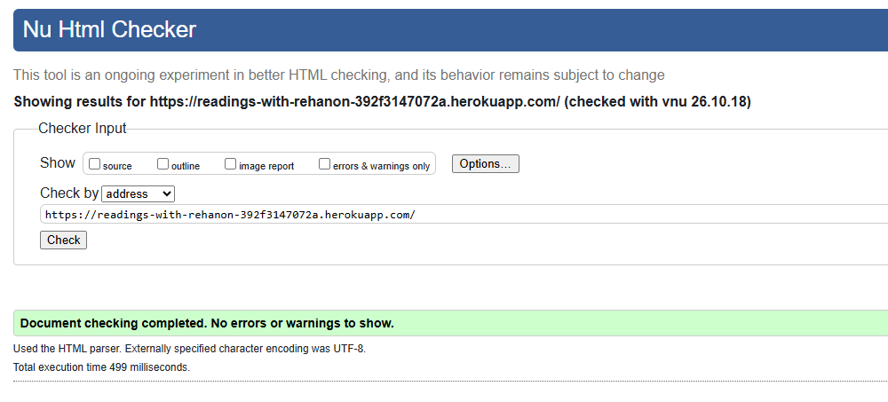 | Pass |
| [reading_list.html](readings/templates/readings/reading_list.html) | [HTML Validator](https://validator.w3.org/nu/?doc=https%3A%2F%2Freadings-with-rehanon-392f3147072a.herokuapp.com%2Freadings%2F) | 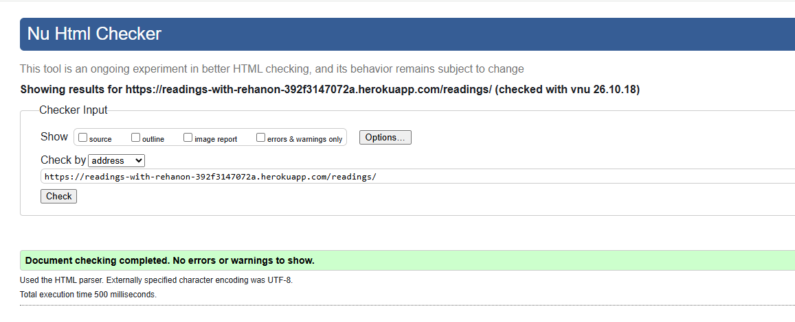 | Pass |
| [reading_detail.html](readings/templates/readings/reading_detail.html) | [HTML Validator](https://validator.w3.org/nu/?doc=https%3A%2F%2Freadings-with-rehanon-392f3147072a.herokuapp.com%2Freadings%2Fbirth-chart) | 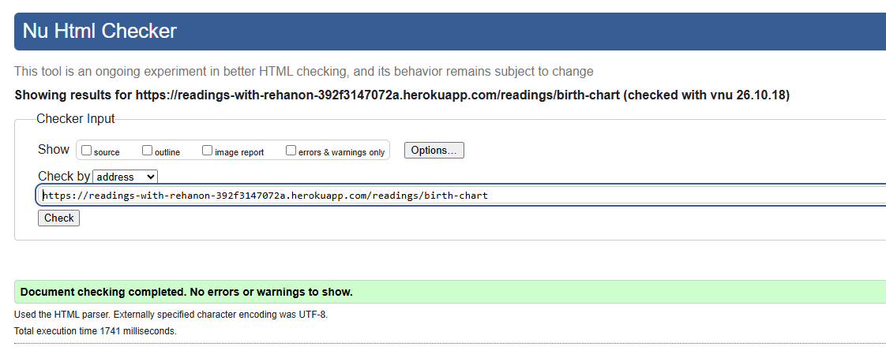 | Pass |
| [login.html](templates/account/login.html) | [HTML Validator](https://validator.w3.org/nu/?doc=https%3A%2F%2Freadings-with-rehanon-392f3147072a.herokuapp.com%2Faccounts%2Flogin%2F) | 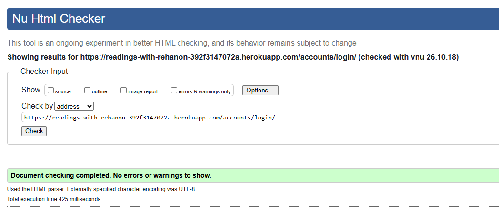 | Pass |
| [signup.html](templates/account/signup.html) | [HTML Validator](https://validator.w3.org/nu/?doc=https%3A%2F%2Freadings-with-rehanon-392f3147072a.herokuapp.com%2Faccounts%2Fsignup%2F) | 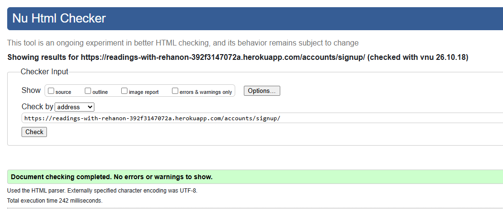 | Pass |
| [404.html](templates/404.html) | Direct Input | 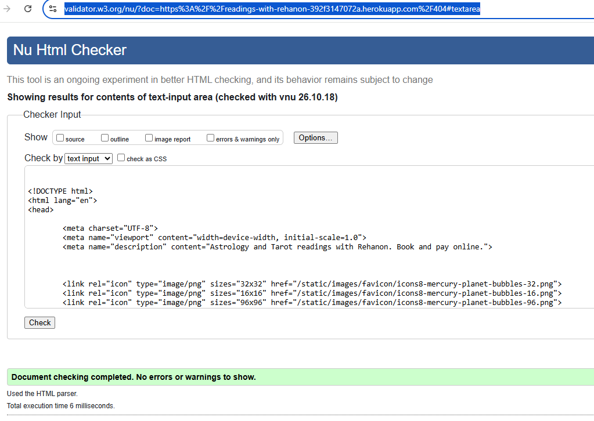 | Pass |
| [my_bookings.html](bookings/templates/bookings/my_bookings.html) | Direct Input | 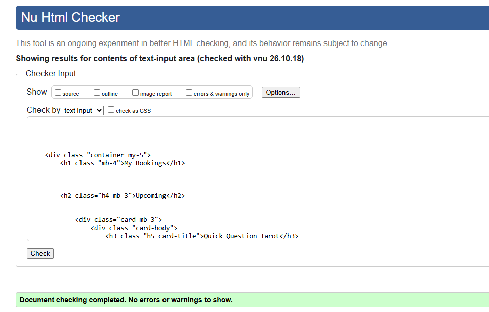 | Pass |
| [book_reading.html](bookings/templates/bookings/book_reading.html) | Direct Input | 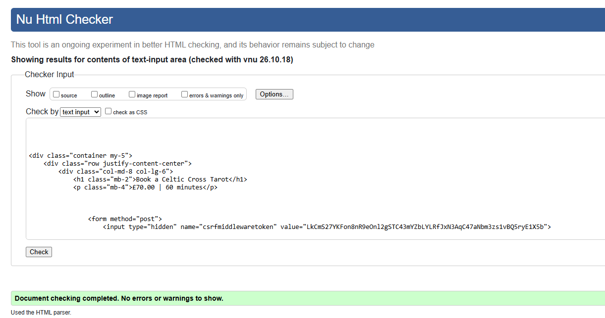 | Pass |
| [cancel_booking.html](bookings/templates/bookings/cancel_booking.html) | Direct Input | 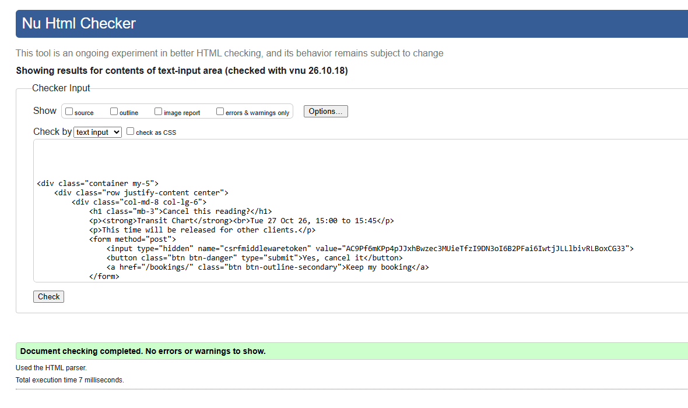 |Pass |
| [reschedule_booking.html](bookings/templates/bookings/reschedule_booking.html) | Direct Input | 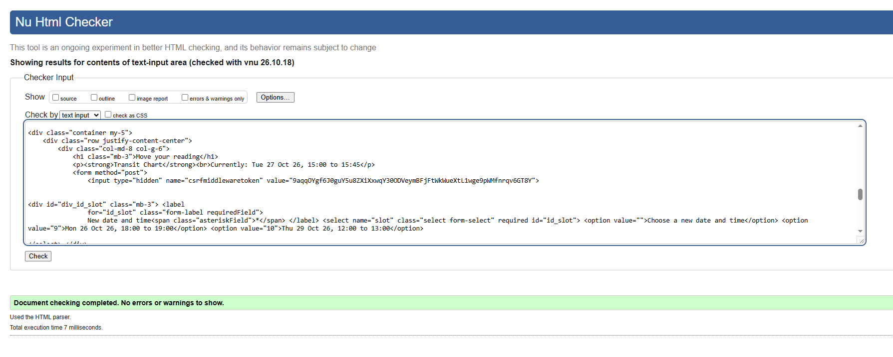 | Pass |
| [checkout.html](checkout/templates/checkout/checkout.html) | Direct Input | 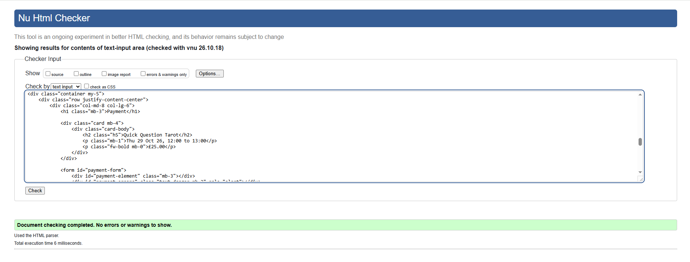 | Pass |
| [checkout_success.html](checkout/templates/checkout/checkout_success.html) | Direct Input | 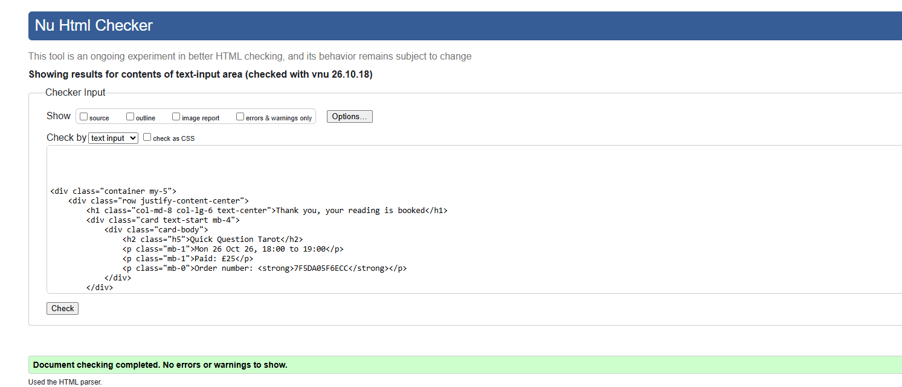 | Pass |
| [manage_slots.html](bookings/templates/bookings/manage_slots.html) | Direct Input | 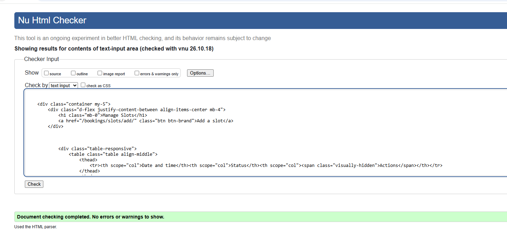 | Pass |
| [reading_form.html](readings/templates/readings/reading_form.html) | Direct Input | 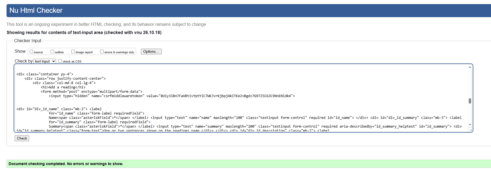 | Pass |

### CSS
I have used the recommended [CSS Jigsaw Validator](https://jigsaw.w3.org/css-validator) to validate all of my CSS files.
| File | URL |Screenshot | Result |
|----|----|----|----|
| [style.css](static/css/style.css) | [CSS Validator](https://jigsaw.w3.org/css-validator/validator?uri=https%3A%2F%2Freadings-with-rehanon-392f3147072a.herokuapp.com%2Fstatic%2Fcss%2Fstyle.css&profile=css3svg&usermedium=all&warning=1&vextwarning=&lang=en) | 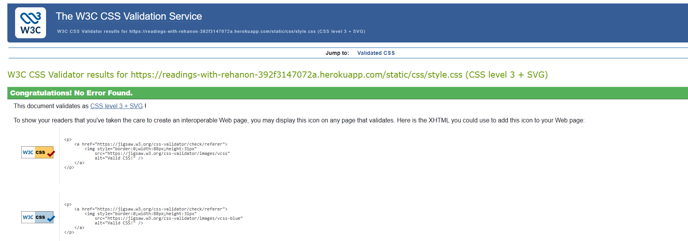 | Pass |

### JavaScript (JSHint)

| File | Screenshot | Result |
| ---- | ---------- | ---- |
| [stripe_payment.js](checkout/static/checkout/js/stripe_payment.js) | 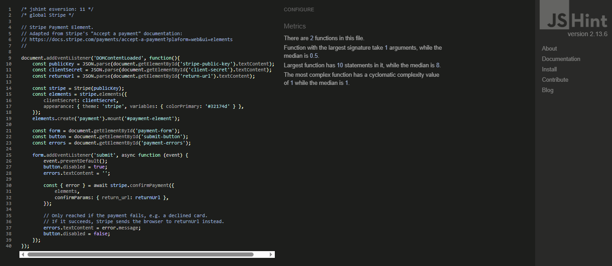 | Pass |
### Python (PEP8)

All Python files were checked with flake8 locally and the CI Python Linter.
All pass with no errors.

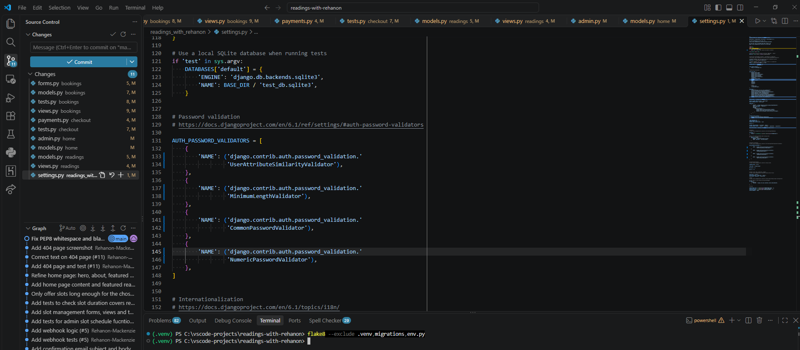

| App | File | URL | Screenshot | Result |
| --- | ---- | --- | ---------- | -------|
| home | [tests.py](/home/tests.py) | [PEP8 CI Link](https://pep8ci.herokuapp.com/https://raw.githubusercontent.com/Rehanon-Mackenzie/readings-with-rehanon/refs/heads/main/home/tests.py) | 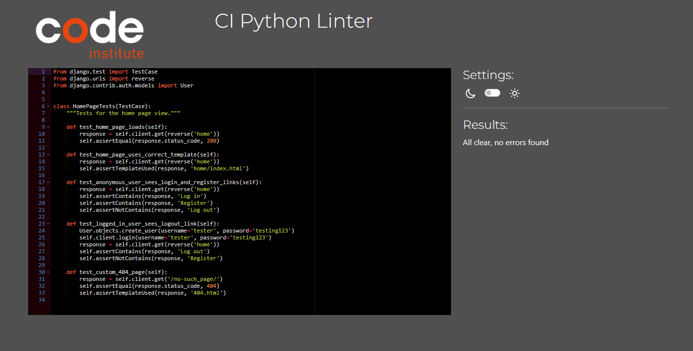 | Pass |
| home | [urls.py](/home/urls.py) | [PEP8 CI Link](https://pep8ci.herokuapp.com/https://raw.githubusercontent.com/Rehanon-Mackenzie/readings-with-rehanon/refs/heads/main/home/urls.py) | 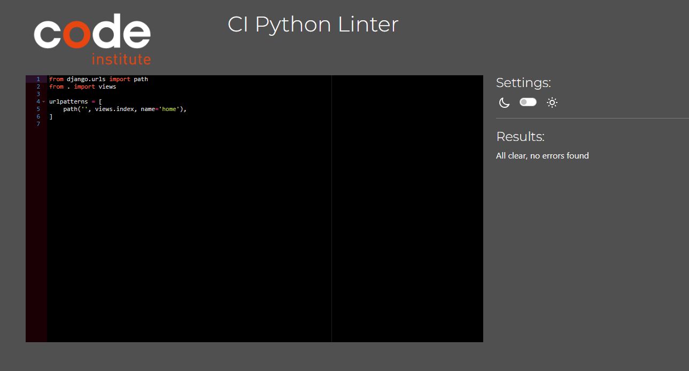 | Pass |
| home | [views.py](/home/views.py) | [PEP8 CI Link](https://pep8ci.herokuapp.com/https://raw.githubusercontent.com/Rehanon-Mackenzie/readings-with-rehanon/refs/heads/main/home/views.py) | 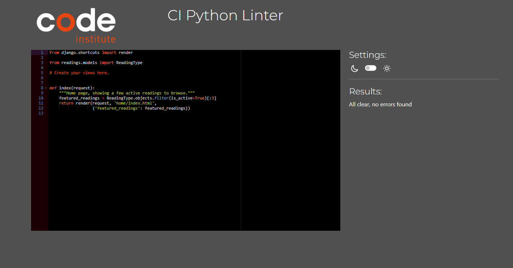 | Pass |
| readings | [views.py](/readings/views.py) | [PEP8 CI Link](https://pep8ci.herokuapp.com/https://raw.githubusercontent.com/Rehanon-Mackenzie/readings-with-rehanon/refs/heads/main/readings/views.py) | 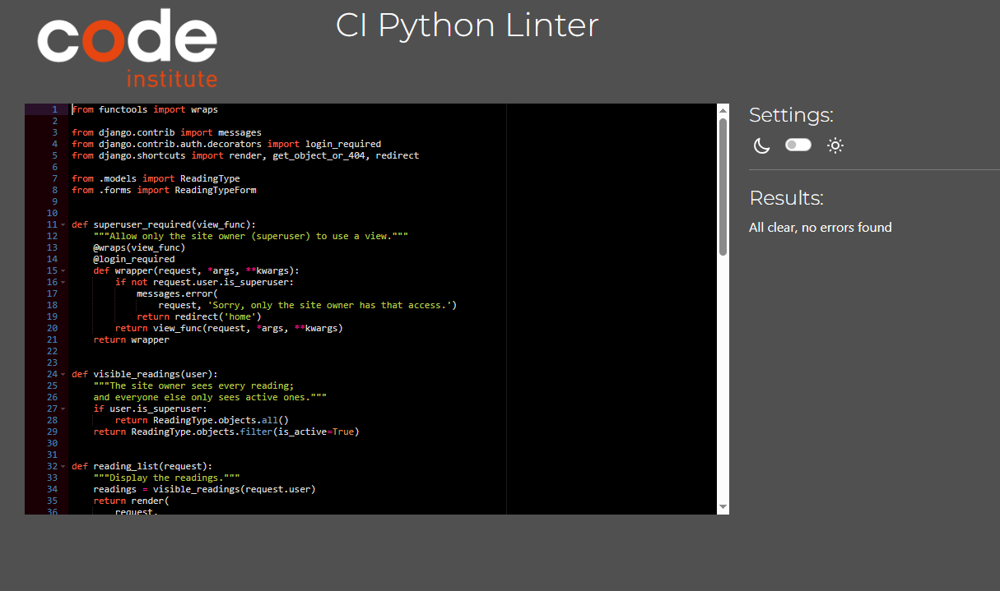 | Pass |
| readings | [admin.py](/readings/admin.py) | [PEP8 CI Link](https://pep8ci.herokuapp.com/https://raw.githubusercontent.com/Rehanon-Mackenzie/readings-with-rehanon/refs/heads/main/readings/admin.py) |  | Pass |
| readings | [forms.py](/readings/forms.py) | [PEP8 CI Link](https://pep8ci.herokuapp.com/https://raw.githubusercontent.com/Rehanon-Mackenzie/readings-with-rehanon/refs/heads/main/readings/forms.py) | 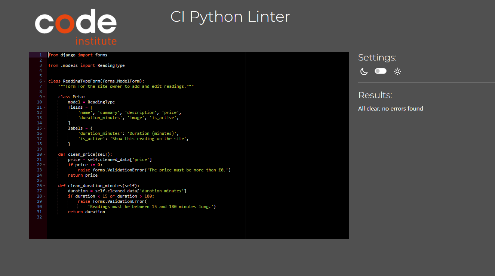 | Pass |
| readings | [models.py](/readings/models.py) | [PEP8 CI Link](https://pep8ci.herokuapp.com/https://raw.githubusercontent.com/Rehanon-Mackenzie/readings-with-rehanon/refs/heads/main/readings/models.py) | 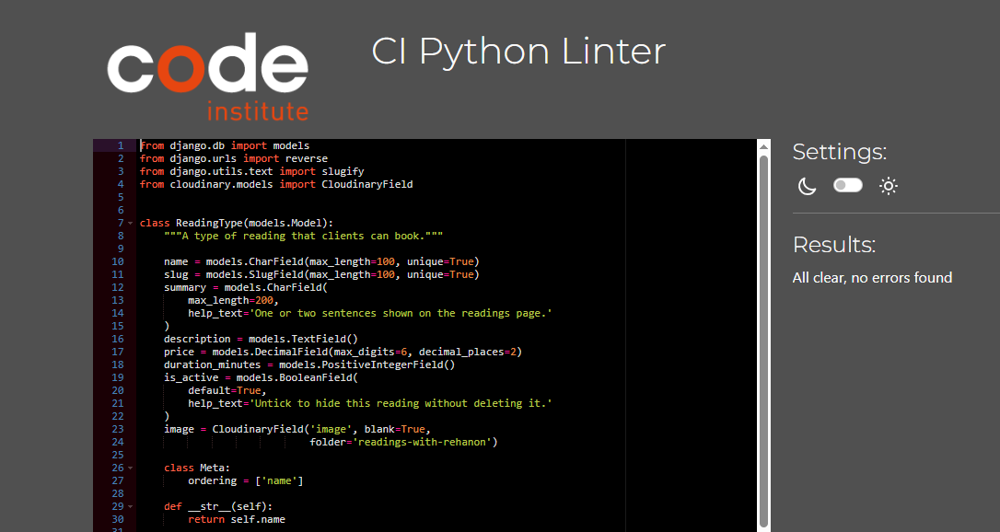 | Pass |
| readings | [tests.py](/readings/tests.py) | [PEP8 CI Link](https://pep8ci.herokuapp.com/https://raw.githubusercontent.com/Rehanon-Mackenzie/readings-with-rehanon/refs/heads/main/readings/tests.py) | 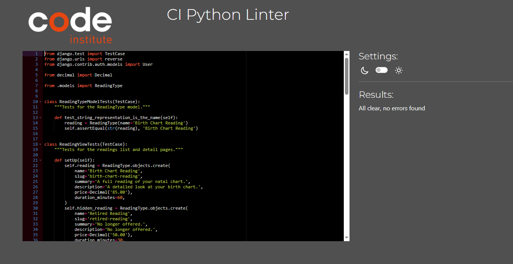 | Pass |
| readings | [urls.py](/readings/urls.py) | [PEP8 CI Link](https://pep8ci.herokuapp.com/https://raw.githubusercontent.com/Rehanon-Mackenzie/readings-with-rehanon/refs/heads/main/readings/urls.py) | 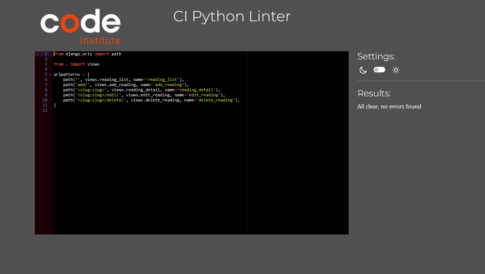 | Pass |
| bookings | [admin.py](/bookings/admin.py) | [PEP8 CI Link](https://pep8ci.herokuapp.com/https://raw.githubusercontent.com/Rehanon-Mackenzie/readings-with-rehanon/refs/heads/main/bookings/admin.py) | 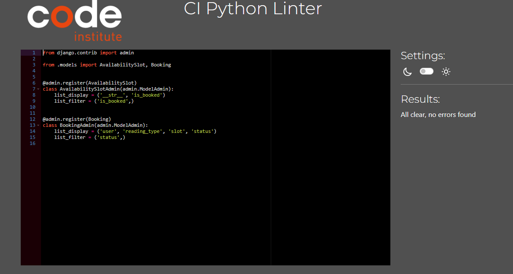 | Pass |
| bookings | [forms.py](/bookings/forms.py) | [PEP8 CI Link](https://pep8ci.herokuapp.com/https://raw.githubusercontent.com/Rehanon-Mackenzie/readings-with-rehanon/refs/heads/main/bookings/forms.py) | 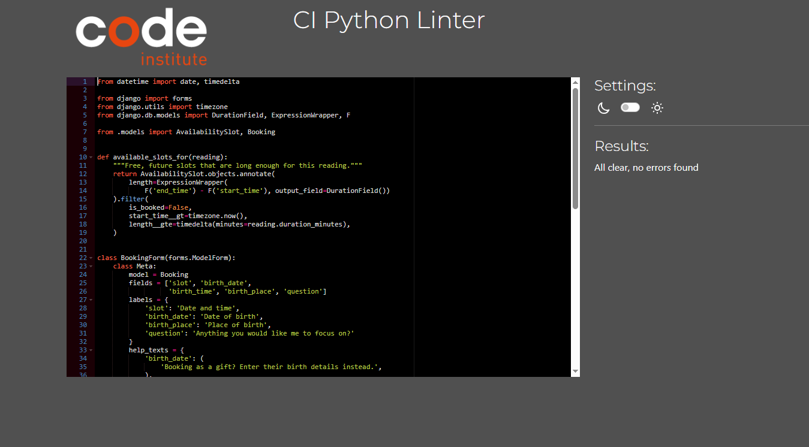 | Pass |
| bookings | [models.py](/bookings/models.py) | [PEP8 CI Link](https://pep8ci.herokuapp.com/https://raw.githubusercontent.com/Rehanon-Mackenzie/readings-with-rehanon/refs/heads/main/bookings/models.py) | 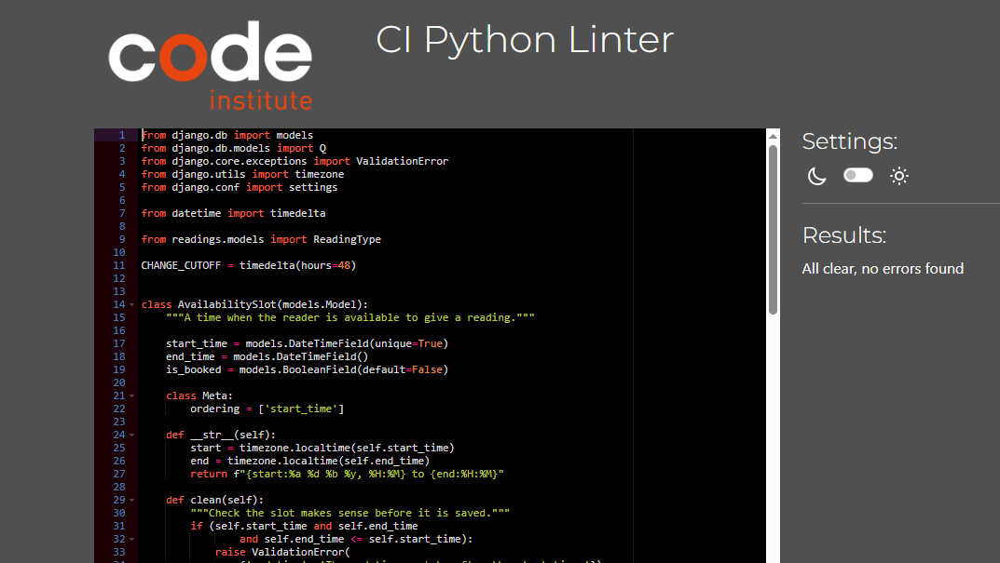 | Pass |
| bookings | [tests.py](/bookings/tests.py) | [PEP8 CI Link](https://pep8ci.herokuapp.com/https://raw.githubusercontent.com/Rehanon-Mackenzie/readings-with-rehanon/refs/heads/main/bookings/tests.py) | 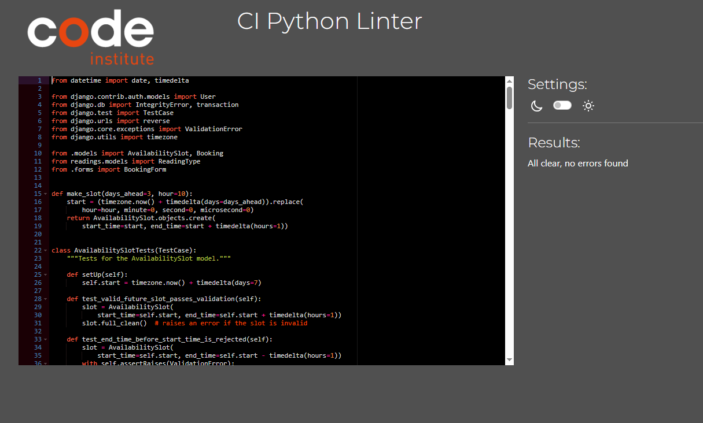 | Pass |
| bookings | [urls.py](/bookings/urls.py) | [PEP8 CI Link](https://pep8ci.herokuapp.com/https://raw.githubusercontent.com/Rehanon-Mackenzie/readings-with-rehanon/refs/heads/main/bookings/urls.py) | 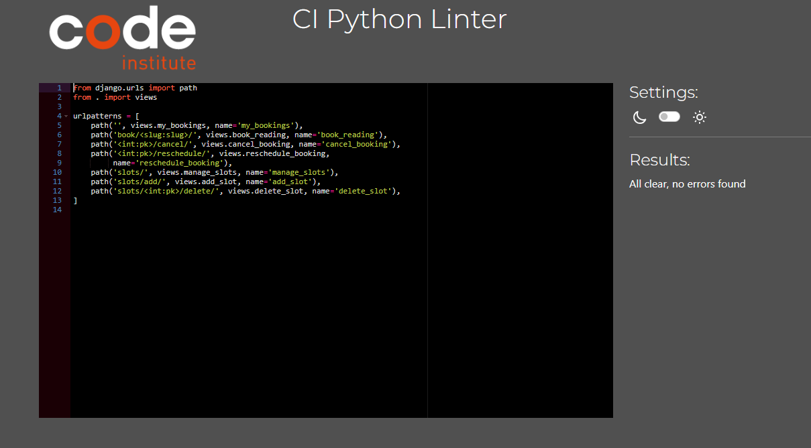 | Pass |
| bookings | [views.py](/bookings/views.py) | [PEP8 CI Link](https://pep8ci.herokuapp.com/https://raw.githubusercontent.com/Rehanon-Mackenzie/readings-with-rehanon/refs/heads/main/bookings/views.py) | 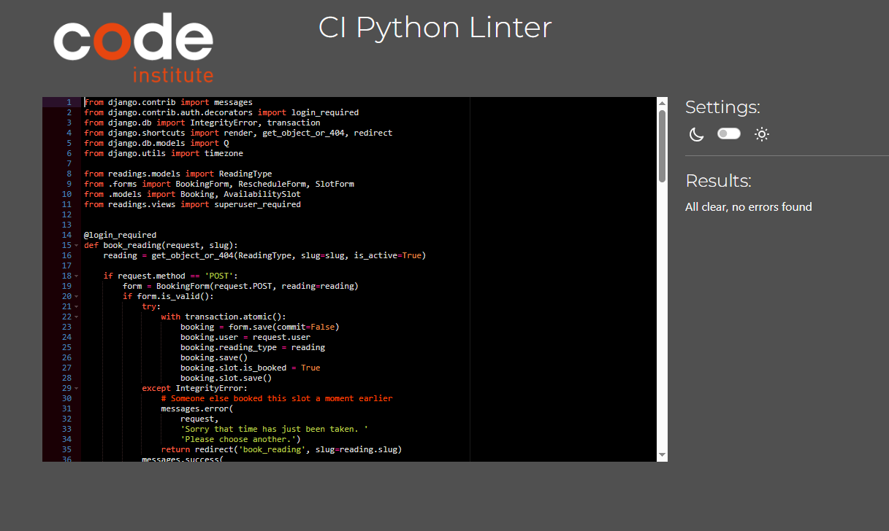 | Pass |
| checkout | [admin.py](/checkout/admin.py) | [PEP8 CI Link](https://pep8ci.herokuapp.com/https://raw.githubusercontent.com/Rehanon-Mackenzie/readings-with-rehanon/refs/heads/main/checkout/admin.py) | 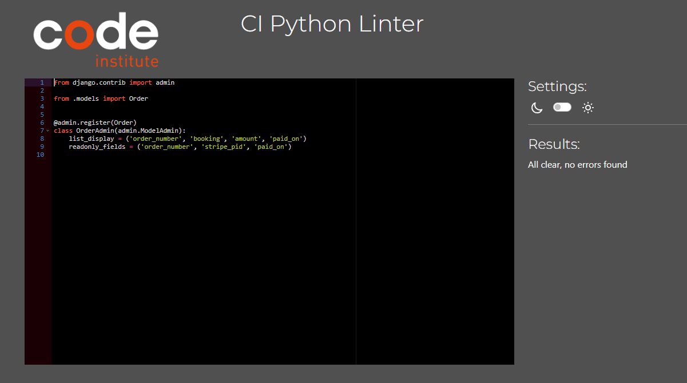 | Pass |
| checkout | [models.py](/checkout/models.py) | [PEP8 CI Link](https://pep8ci.herokuapp.com/https://raw.githubusercontent.com/Rehanon-Mackenzie/readings-with-rehanon/refs/heads/main/checkout/models.py) | 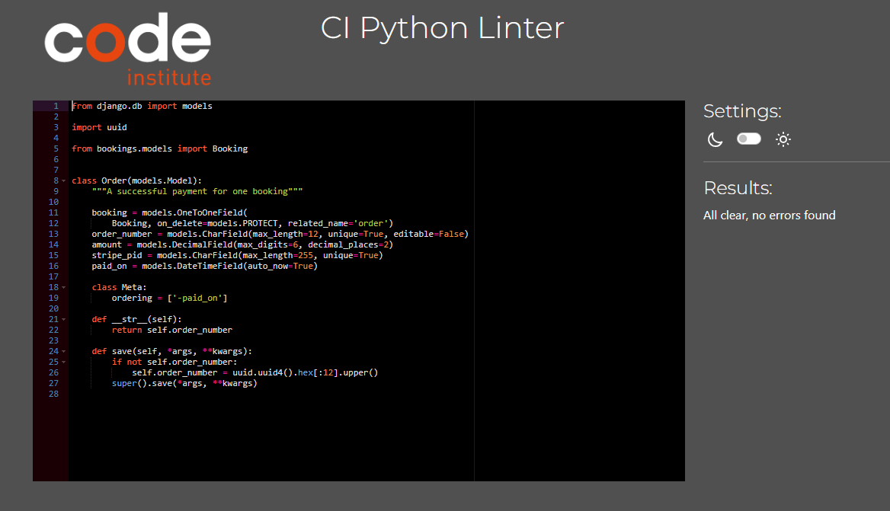 | Pass |
| checkout | [payments.py](/checkout/payments.py) | [PEP8 CI Link](https://pep8ci.herokuapp.com/https://raw.githubusercontent.com/Rehanon-Mackenzie/readings-with-rehanon/refs/heads/main/checkout/payments.py) | 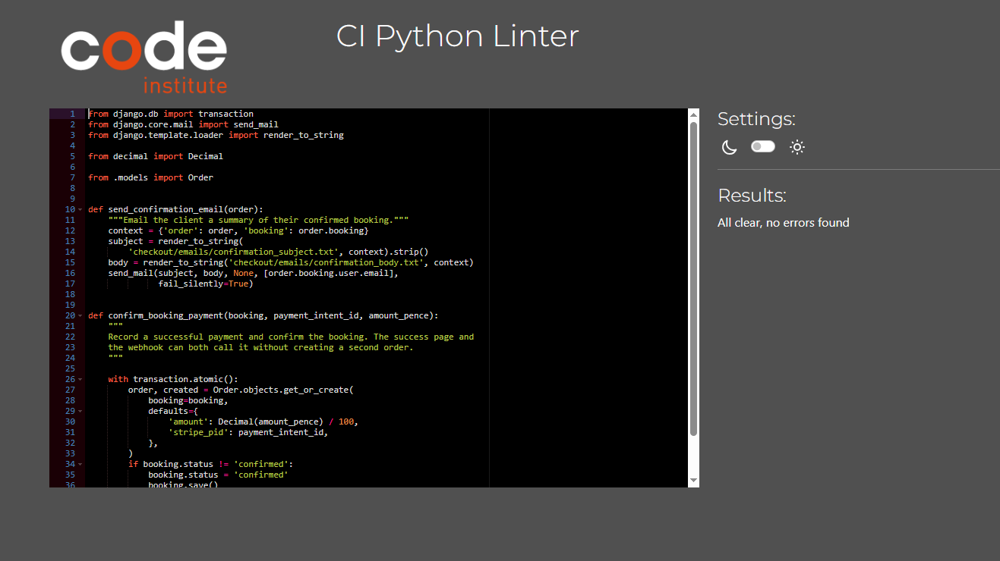 | Pass |
| checkout | [tests.py](/checkout/tests.py) | [PEP8 CI Link](https://pep8ci.herokuapp.com/https://raw.githubusercontent.com/Rehanon-Mackenzie/readings-with-rehanon/refs/heads/main/checkout/tests.py) | 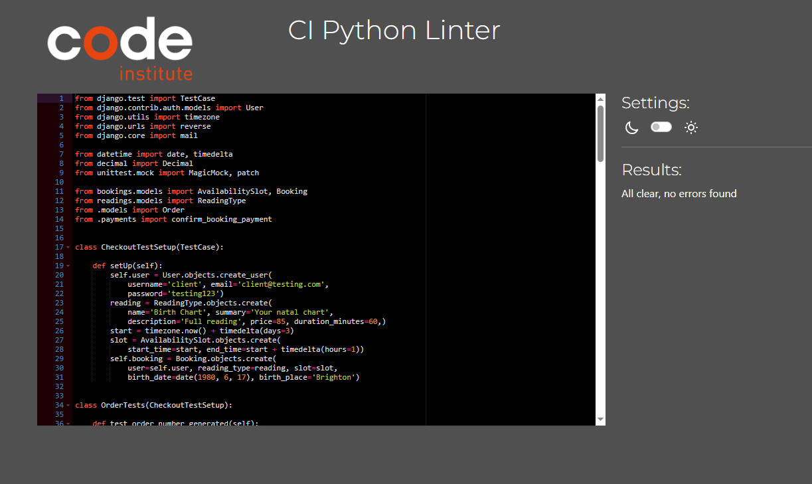 | Pass |
| checkout | [urls.py](/checkout/urls.py) | [PEP8 CI Link](https://pep8ci.herokuapp.com/https://raw.githubusercontent.com/Rehanon-Mackenzie/readings-with-rehanon/refs/heads/main/checkout/urls.py) | 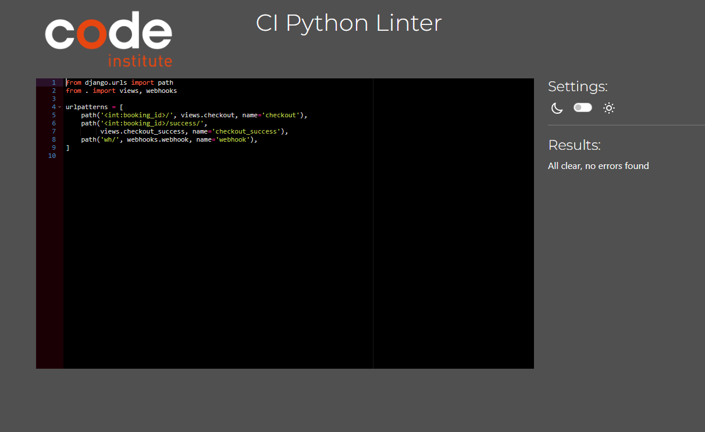 | Pass |
| checkout | [views.py](/checkout/views.py) | [PEP8 CI Link](https://pep8ci.herokuapp.com/https://raw.githubusercontent.com/Rehanon-Mackenzie/readings-with-rehanon/refs/heads/main/checkout/views.py) | 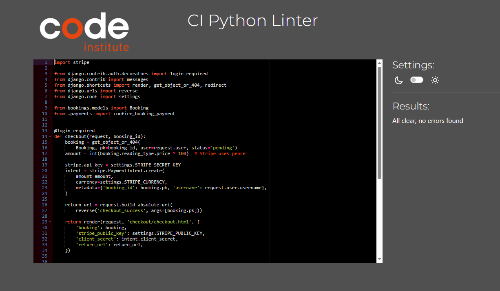 | Pass |
| checkout | [webhooks.py](/checkout/webhooks.py) | [PEP8 CI Link](https://pep8ci.herokuapp.com/https://raw.githubusercontent.com/Rehanon-Mackenzie/readings-with-rehanon/refs/heads/main/checkout/webhooks.py) | 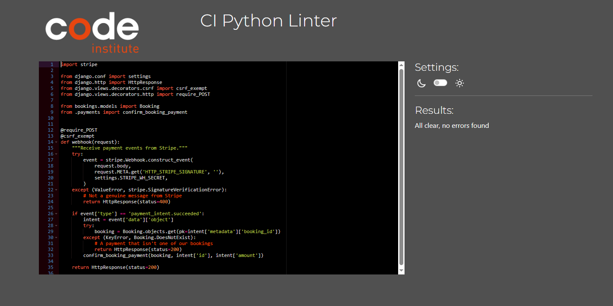 | Pass |
| readings_with_rehanon | [urls.py](/readings_with_rehanon/urls.py) | [PEP8 CI Link](https://pep8ci.herokuapp.com/https://raw.githubusercontent.com/Rehanon-Mackenzie/readings-with-rehanon/refs/heads/main/readings_with_rehanon/urls.py) | 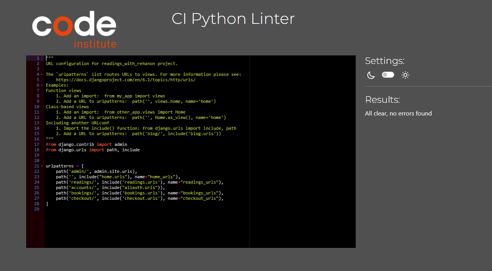 | Pass |
| readings_with_rehanon | [settings.py](/readings_with_rehanon/settings.py) | [PEP8 CI Link](https://pep8ci.herokuapp.com/https://raw.githubusercontent.com/Rehanon-Mackenzie/readings-with-rehanon/refs/heads/main/readings_with_rehanon/settings.py) | 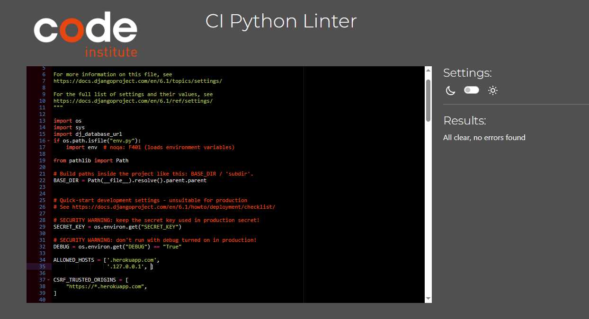 | Pass |

### Lighthouse 
I used the Lighthouse extension with Chrome Developer Tools to test performance, accessibility, best practices and SEO of the website.

| Page | Device | Screenshot |
| ---- | ------ | ---------- |
| Home | Desktop | 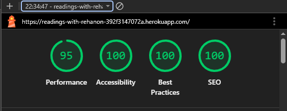 |
| Home | Mobile | 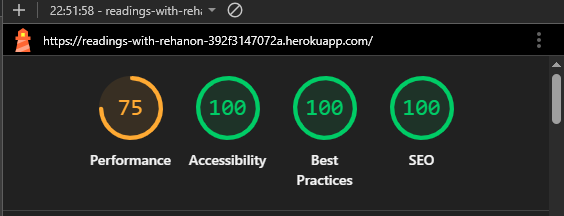 |
| Readings | Desktop | 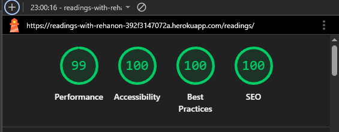 |
| Readings | Mobile | 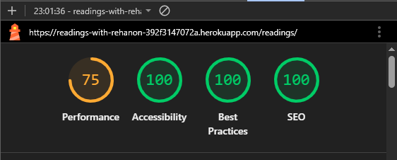 |
| My Bookings | Desktop | 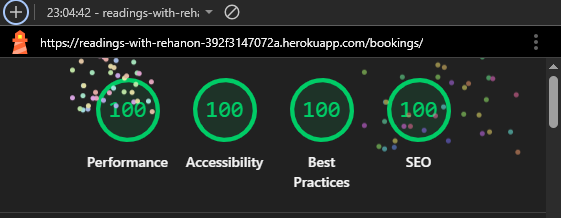 |
| My Bookings | Mobile | 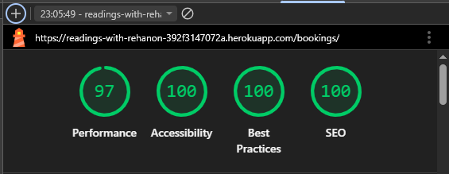 |

>[!Note]
>**Mobile home page (Performance 75)**: Lighthouse simulates a slow phone and network.  The main factors were render-blocking CDN stylesheets (Bootstrap, Font Awesome, Google Fonts), unused CSS from Bootstrap, and the profile image as the Largest Contentful Paint element. Desktop scored 95, and Accessibility, Best Practices and SEO scored 100 on both. Future improvements: self-host and trim the CSS, enable WhiteNoise compression and caching, and preload the hero image.